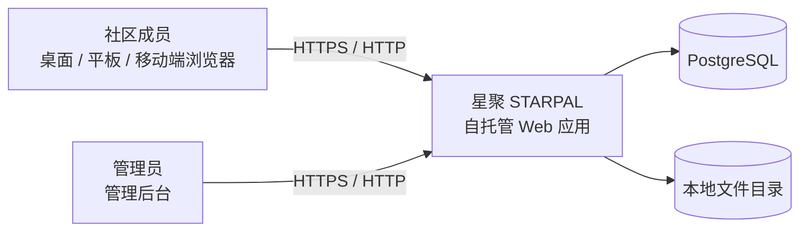
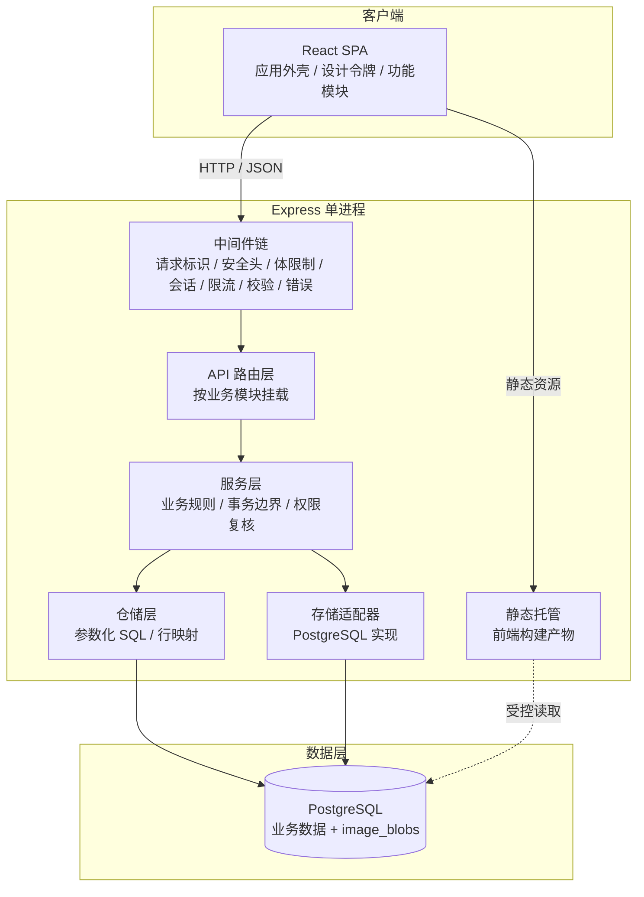
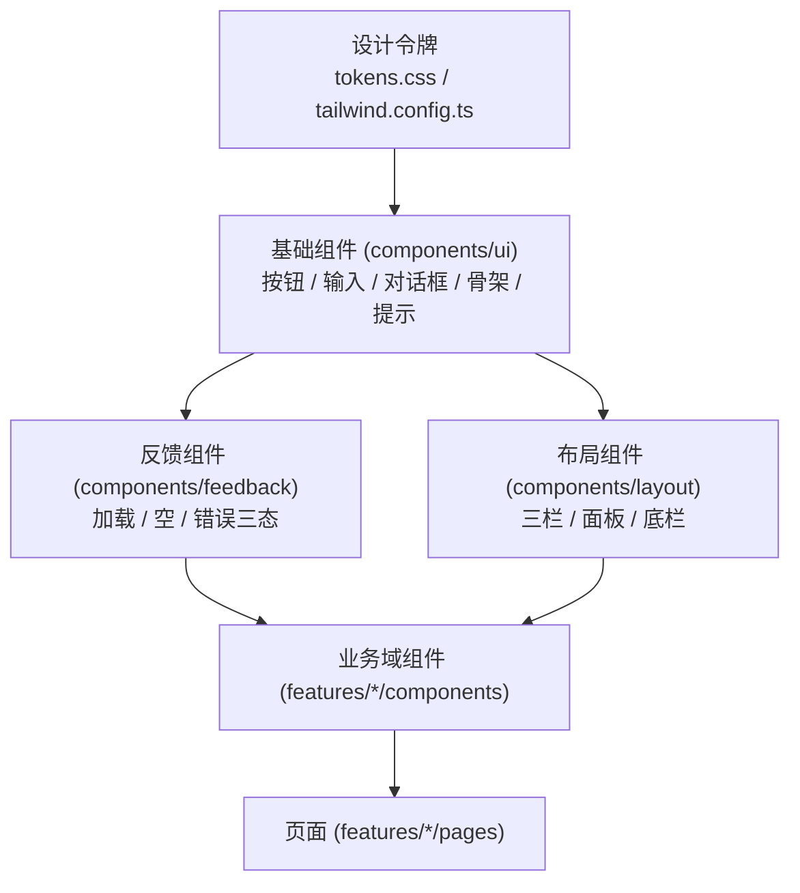
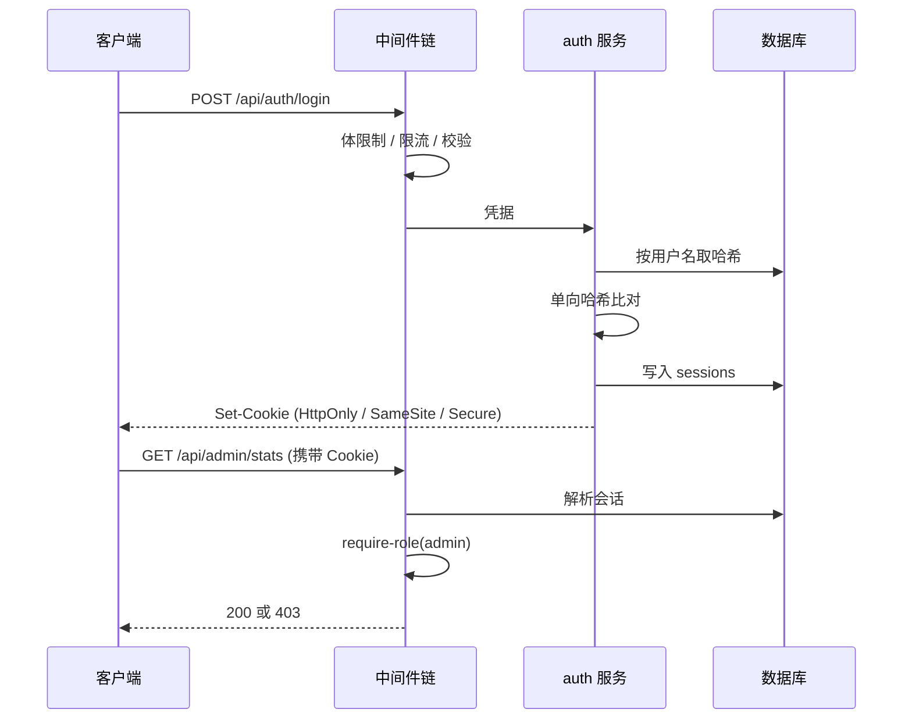
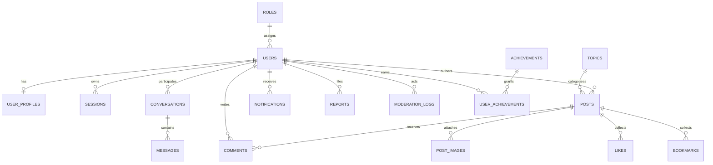
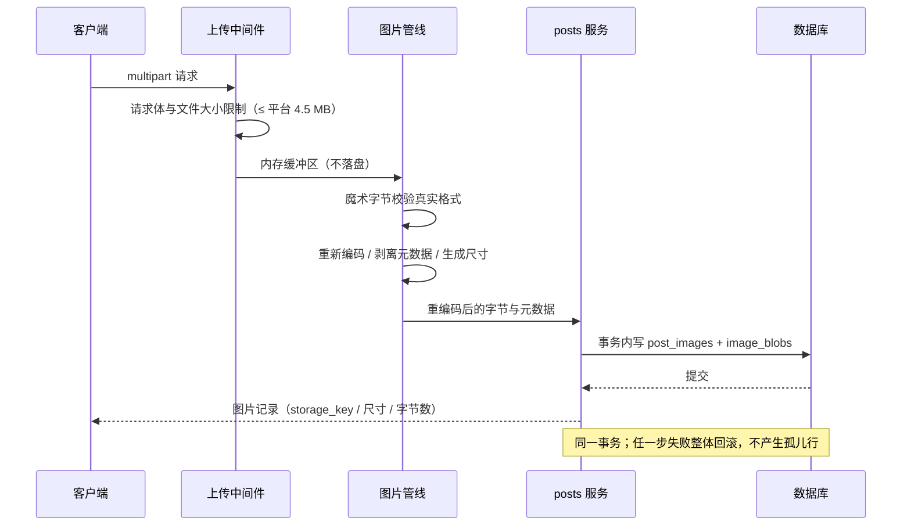

# 星聚 STARPAL · 系统架构设计文档

| 项目 | 内容 |
| --- | --- |
| 产品 | 星聚 STARPAL |
| 版本 | v1.0.0 |
| 文档状态 | 基线（Baseline） |
| 关联文档 | [产品需求文档](./PRD.md) · [实施计划](./IMPLEMENTATION-PLAN.md) · [部署与配置指南](./DEPLOYMENT.md) |

---

## 1. 文档说明

### 1.1 目的

本文定义系统的分层、模块边界、依赖方向、接口契约、数据模型、安全设计与扩展点，用于指导实现与评审。需求定义见 [PRD.md](./PRD.md)；交付顺序见 [IMPLEMENTATION-PLAN.md](./IMPLEMENTATION-PLAN.md)。

### 1.2 架构表达约定

- 图采用 Mermaid，包含上下文视图、容器视图、实体关系与关键流程时序。
- 架构决策以 `ADR-xxx` 编号登记，包含决策、理由、放弃的备选与影响。
- 接口路径、数据表、模块目录、错误码均为**契约**，变更须同步更新本文与追踪矩阵。

### 1.3 读者

前端、后端、测试、部署维护人员；架构评审参与者。

---

## 2. 架构目标与约束

### 2.1 目标

| 编号 | 目标 | 落地手段 |
| --- | --- | --- |
| `G-01` | 前后端职责分离 | 独立代码树、独立构建、契约化的 REST API；开发期独立进程，生产期同进程托管静态产物 |
| `G-02` | 前端模块化 | 按业务域划分 `features`，域内自包含 UI / 数据 / 类型；通用能力下沉至 `components` 与 `lib` |
| `G-03` | 后端模块化 | 按业务域划分 `modules`，域内固定四层结构；跨模块只经服务层公开接口 |
| `G-04` | 低耦合 | 单向依赖、禁止跨层与跨模块深层引用、依赖注入限于少量适配器 |
| `G-05` | 高扩展 | 预留明确扩展点，每个扩展点写明「接入方式」与「不改动范围」 |
| `G-06` | 可收口 | 冻结 v1.0 的表结构、模块清单与端点清单；变更走 ADR 与迁移；不引入开放式插件体系 |
| `G-07` | 避免过度设计 | 单进程、单数据库、无中间件集群；不引入用不上的抽象层 |

### 2.2 约束

| 编号 | 约束 | 来源 |
| --- | --- | --- |
| `C-01` | 服务端为 Express + PostgreSQL | 需求文档 §8 |
| `C-02` | 单实例、单进程、读多写少、小规模 | PRD §2.3 |
| `C-03` | 不依赖付费第三方服务；图片存本地目录 | PRD §2.3 / `NFR-DATA-05` |
| `C-04` | 运行时为 Node.js 22 LTS，版本由 `.nvmrc` 与 `engines.node` 锁定 | 环境基线 |
| `C-05` | 配置全部经环境变量注入，仓库不含真实凭据 | `NFR-OPS-06` / `NFR-SEC-06` |
| `C-06` | 响应式 Web，一套代码覆盖桌面与移动端浏览器 | PRD §2.3 |
| `C-07` | 前端产物为静态文件，可由服务端进程直接托管 | 部署形态 |

### 2.3 非目标（明确不实现）

> 本节是「避免架构收口不了」的核心约束。以下能力在 v1.0 不实现、不预留运行时扩展框架，仅保留数据或接口层面的兼容余地。

| 非目标 | 说明 |
| --- | --- |
| 运行时插件系统 / 插件注册中心 | 不提供动态装载、钩子注册或插件市场式抽象 |
| 通用抽象工厂 / 泛型仓储基类 | 每个模块显式编写自己的仓储，不追求消灭重复 SQL |
| 事件总线 / 消息队列 / 领域事件泛化 | 交互通过服务层同步调用，跨模块通知由调用方显式触发 |
| 微服务 / 服务发现 / 多容器编排 | 单进程单数据库 |
| CQRS、读写分离、物化视图体系 | 规模假设下无收益 |
| 多租户、联邦化互联、国际化全量翻译 | 超出 v1.0 边界 |
| 可配置的规则引擎 / 低代码表单 | 业务规则以代码与数据表表达，不做可视化编排 |
| 缓存集群、Redis、外部搜索服务 | 数据库索引与分页即可满足 |

### 2.4 架构原则

1. **依赖单向**：`app → features → components → lib`；后端 `routes → controller → service → repository → db`。反向依赖一律禁止。
2. **接口先行**：前后端以 API 契约为界；契约变更须同步文档与类型定义。
3. **薄控制器**：控制器只做参数解析、权限前置与响应组装；业务规则在服务层。
4. **SQL 只在仓储层**：控制器与服务不得拼接 SQL。
5. **事务在服务层**：跨表一致性由服务层划定边界，仓储不自行提交。
6. **配置集中**：令牌、权重、限制阈值、错误码集中定义，禁止散落字面量。
7. **渐进扩展**：先满足 v1.0，扩展点以「新增模块 / 替换适配器」为主，不提前引入抽象层。

### 2.5 收口机制

| 机制 | 内容 |
| --- | --- |
| 冻结清单 | v1.0 冻结 **18 张表**（§7.2）、**16 个后端模块**（§5.3）、**API 端点清单**（§6.2） |
| 变更流程 | 新增需求 → ADR 记录 → 更新本文与 PRD 追踪矩阵 → 新增迁移 → 实现 → 验收 |
| 表结构变更 | 只能新增迁移文件，不得修改已执行迁移 |
| 依赖变更 | 新增依赖须说明用途、替代方案与被排除的方案 |
| 完成判据 | PRD 全部 `FR-*` / `NFR-*` 有实现，`AC-01…18` 均有真实验证记录 |

---

## 3. 架构总览

### 3.1 系统上下文



系统不依赖外部身份服务、验证码服务、对象存储或分析平台。全部外部交互由使用者浏览器与自托管进程构成。

### 3.2 容器视图



**前后端分离的定义**：开发期前端由独立开发服务器提供，通过代理访问 `/api`；生产期前端编译为静态产物，由同一 Express 进程托管。二者在**代码树、构建流程、职责与契约**上始终分离；进程合并仅为降低部署复杂度，不意味着职责合并。

### 3.3 部署视图

| 环境 | 前端 | 后端 | 数据库 | 说明 |
| --- | --- | --- | --- | --- |
| 开发 | 独立开发服务器（热更新） | Express API 进程 | 本地 PostgreSQL | 前端通过代理访问 `/api` |
| 测试 | 构建产物 | Express 单进程托管 | 独立测试库 | 每次测试前执行迁移与清理 |
| 自托管 | 构建产物 | Express 单进程同时托管静态资源与 API | 同环境或可达实例 | 反向代理终止 TLS；图片入库，无需挂载卷 |

配置、迁移、备份与启动流程见 [DEPLOYMENT.md](./DEPLOYMENT.md)。

### 3.4 架构决策记录（ADR 摘要）

| 编号 | 决策 | 理由 | 放弃的备选 | 影响 |
| --- | --- | --- | --- | --- |
| `ADR-001` | Express 单进程同时提供 API 与静态产物 | 部署单元少、无跨域、资源占用低 | 前后端双服务 / 独立 Web 服务器 | 静态与 API 共享进程上限；后续可拆分 |
| `ADR-002` | React + TypeScript + Vite 的 SPA | 组件化与设计令牌落地成熟，产物为静态文件 | Next.js SSR / 服务端模板 | 无服务端渲染，不依赖搜索收录 |
| `ADR-003` | PostgreSQL + 版本化 SQL 迁移 | 需求指定；约束、事务、部分索引能力完整 | SQLite 作为主库 | 需管理独立数据库进程；保留迁移退路 |
| `ADR-004` | Tailwind CSS + 设计令牌 + shadcn/Radix 组件源码 | 令牌唯一来源；组件源码可改；无障碍底座成熟 | 传统黑盒组件库 / 特效组件集 | 视觉令牌须自行维护，不套用默认主题 |
| `ADR-005` | 服务端会话表 + `HttpOnly` Cookie | 可主动失效、登出可靠、便于限流 | 无状态不可撤销令牌 | 会话需持久化与定期清理 |
| `ADR-006` | 只采集用户名与密码；邀请码经环境变量注入 | 采集最小化；低规模下邀请码成本最低 | 邮箱 / 手机验证 / 第三方验证码 | 无法彻底阻断自动化注册，需纵深防刷 |
| `ADR-007` | 存储适配器接口（具体实现由 `ADR-014` 修订） | 零外部依赖，换对象存储只替换实现 | 直接写死文件系统调用 | 接口不变；`local-disk` 实现仅适用于有持久卷的单实例部署 |
| `ADR-008` | 确定性排序，不引入机器学习 | 小规模数据下可解释、零成本 | 个性化推荐 / 行为画像 | 排序质量依赖人工权重配置 |
| `ADR-009` | 私信 v1.0 为留言式，表结构一次建到位 | 避免实时链路复杂度，后续升级不改表 | 首版即上实时推送 | 消息需刷新可见 |
| `ADR-010` | 软删除 + 只追加审核日志 + 用户主动彻底擦除 | 兼顾追溯与删除权 | 物理级联删除 | 查询须统一携带可见性条件 |
| `ADR-011` | 不引入全局状态库、图表库、动效库 | 服务端状态由请求库管理，客户端状态极少 | Zustand / Recharts / Motion 等 | 复杂动效与图表能力受限 |
| `ADR-012` | Node.js 22 LTS，`.nvmrc` 与 `engines.node` 锁定 | 依赖兼容稳定，开发与部署版本一致 | 升级至更高主版本 | 需 `>=24` 的依赖不予引入 |
| `ADR-013` | 不引入 Redis、消息队列、插件系统 | 见 §2.3 非目标 | 多层缓存 / 事件驱动架构 | 扩展能力通过模块与适配器提供 |
| `ADR-014` | 图片二进制存 PostgreSQL `BYTEA`（`postgres-bytea` 适配器实现） | 部署于 Vercel Serverless，无持久卷且请求体上限 4.5 MB；候选对象存储均需绑定支付方式或会因闲置暂停；本方案零新增依赖、事务内一致、随 `pg_dump` 一并备份 | 本地磁盘（Serverless 不可写、不持久）/ Vercel Blob（引入外部 SDK、备份与数据库分离、两处删除易不一致）/ Cloudflare R2（需绑定信用卡） | 图片占用数据库免费额度（Neon 免费层每项目 1 GB）；读图经函数返回，须携带长缓存头；总量超阈值时按 §8.4 迁移至对象存储 |

---

## 4. 前端架构

### 4.1 分层

| 层 | 目录 | 职责 | 允许依赖 |
| --- | --- | --- | --- |
| 应用外壳 | `src/app/` | 路由注册、全局 Provider、顶栏 / 侧栏 / 底栏 | `features`、`components`、`lib` |
| 业务域 | `src/features/*` | 单一业务域的页面片段、数据请求、类型与私有组件 | `components`、`lib`、其他域的公开入口 |
| 通用 UI | `src/components/` | 无业务语义的基础组件、布局组件、三态组件 | `lib` |
| 基础设施 | `src/lib/` | API 客户端、请求缓存配置、令牌、工具、常量 | 无业务依赖 |
| 样式 | `src/styles/` | CSS 变量（浅 / 深）、全局基线 | — |
| 类型 | `src/types/` | API 契约类型定义 | — |

### 4.2 目录结构

```text
web/
├── index.html
├── vite.config.ts
├── tailwind.config.ts
├── tsconfig.json
├── package.json
└── src/
    ├── main.tsx
    ├── app/
    │   ├── router.tsx                 # 路由表与懒加载边界
    │   ├── providers.tsx              # QueryProvider / ThemeProvider
    │   └── shell/
    │       ├── AppShell.tsx
    │       ├── TopBar.tsx
    │       ├── Sidebar.tsx
    │       ├── BottomTabBar.tsx
    │       └── MobileMenu.tsx
    ├── features/
    │   ├── auth/        # 登录、注册、登出、邀请码（已实现）
    │   ├── feed/        # 信息流、三 Tab、游标分页、帖子卡片（已实现）
    │   ├── posts/       # 创建、编辑、详情、相关帖子（已实现）
    │   ├── topics/      # 话题目录、话题详情与筛选（已实现）
    │   ├── comment/     # 评论列表与发表
    │   ├── message/     # 会话与消息（留言式）
    │   ├── notification/
    │   ├── profile/     # 公开页、资料编辑、可选资料（已实现）
    │   ├── achievement/ # 成就时间线、每周热门
    │   ├── search/
    │   ├── report/      # 举报提交
    │   ├── admin/       # 六分区后台
    │   └── export/
    ├── components/
    │   ├── ui/          # shadcn 源码组件：button / dialog / input / dropdown / skeleton / toast
    │   ├── layout/      # 三栏、面板、分隔
    │   └── feedback/    # LoadingSkeleton / EmptyState / ErrorState
    ├── lib/
    │   ├── api-client.ts        # 统一请求、错误归一化、凭据携带
    │   ├── query-client.ts      # 缓存与重试策略
    │   ├── tokens.ts            # 令牌读取与校验
    │   ├── pagination.ts        # 游标工具
    │   └── utils.ts
    ├── hooks/                   # useTheme / useMediaQuery / useScrollRestore
    ├── styles/
    │   ├── tokens.css           # 浅深两套 CSS 变量
    │   └── globals.css
    └── types/
        └── api.d.ts
```

每个 `features/<domain>/` 内部采用一致结构：

```text
features/<domain>/
├── index.ts            # 唯一公开出口
├── api.ts              # 该域的 API 调用
├── queries.ts          # 请求缓存键与查询 / 变更定义
├── types.ts            # 域内类型（API 契约类型从 src/types 引入）
├── components/         # 域私有组件
└── pages/              # 路由级页面（可选）
```

### 4.3 依赖方向规则

| 起点 \ 终点 | `app` | `features/A` | `components` | `lib` |
| --- | :---: | :---: | :---: | :---: |
| `app` | — | ✓ | ✓ | ✓ |
| `features/A` | ✗ | ✓（仅 `index.ts`） | ✓ | ✓ |
| `components` | ✗ | ✗ | — | ✓ |
| `lib` | ✗ | ✗ | ✗ | — |

- **禁止** `features/A` 引用 `features/B` 的内部路径（如 `features/post/components/X`）；跨域复用须提升至 `components` 或 `lib`。
- **禁止** `components` 引入任何业务语义或 API 调用。
- **禁止** 在组件内拼接业务规则（排序权重、权限判断、状态机），统一收敛到 `lib` 或对应 `features` 的 `queries.ts`。
- 深路径引用由 lint 规则（导入边界约束）在构建前拦截。

### 4.4 路由与页面映射

| 路径 | 页面 | 域 | 访问 |
| --- | --- | --- | --- |
| `/` | 首页 / 信息流 | feed | 公开 |
| `/discover` | 发现 | topic | 公开 |
| `/topics` | 话题列表 | topic | 公开 |
| `/topics/:slug` | 话题详情 | topic | 公开 |
| `/posts/new` | 创建帖子 | post | 登录 |
| `/posts/:id` | 帖子详情 | post | 公开（受可见性约束） |
| `/posts/:id/edit` | 编辑帖子 | post | 作者 / 管理员 |
| `/messages` | 会话列表 | message | 登录 |
| `/messages/:id` | 消息列表 | message | 参与者 |
| `/notifications` | 通知 | notification | 登录 |
| `/u/:username` | 公开个人页 | profile | 公开 |
| `/settings` | 资料与主题设置 | profile | 本人 |
| `/achievements` | 成就时间线 | achievement | 登录 |
| `/search` | 搜索结果 | search | 公开 |
| `/reports/new` | 举报提交 | report | 登录 |
| `/admin/*` | 管理后台六分区 | admin | 管理员 |
| `/login` `/register` | 认证 | auth | 访客 |
| `/about` `/guidelines` `/privacy` | 静态说明 | — | 公开 |

前端路由守卫只做体验层跳转，**权限判定以服务端响应为准**。

### 4.5 组件体系



- 玻璃效果以**单一玻璃容器组件**实现，仅用于顶栏、底栏、下拉、浮层与模态框；内容卡片使用实色令牌。
- 所有交互组件基于无障碍原语（Radix UI）构建，保证焦点管理、键盘操作与语义属性。
- 相同视觉意图不得重复实现；新增样式先检查令牌与基础组件是否已覆盖。

### 4.6 状态与数据获取策略

| 状态类别 | 归属 | 实现 |
| --- | --- | --- |
| 服务端数据（帖子、评论、话题、通知） | 请求缓存层 | TanStack Query：缓存键按域命名、失效与重取、乐观更新与失败回滚 |
| 交互临时态（对话框开合、草稿、Tab） | 组件本地状态 | 框架原生状态 |
| 全局偏好（主题） | 轻量持久化 | 本地存储 + 根 Provider 注入 |
| 会话态 | 服务端 | 由 `/api/auth/me` 查询并缓存，前端不自行判定权限 |

**不引入全局状态库**：服务端状态与客户端状态不重叠管理，避免双写与不一致。

**乐观更新约束**：点赞 / 收藏类操作先本地更新，服务端返回后校对；失败须回滚并提示，不得保留「假计数」。

### 4.7 API 客户端层

`lib/api-client.ts` 统一负责：

1. 拼接 `/api` 前缀、携带凭据（同源 Cookie）；
2. 解析统一响应包络，剥离 `data` / `meta`；
3. 将错误响应归一化为领域错误对象（`code` / `message` / `details`）；
4. 处理未授权（触发会话失效流程）与限流（退避提示）；
5. 统一超时与请求取消，保证同一列表仅一个在途请求。

各 `features/*/api.ts` 只描述路径与参数，不重复实现传输逻辑。

### 4.8 样式与设计令牌落地

- 令牌以 CSS 变量定义于 `tokens.css`，浅色为 `:root`、深色为 `[data-theme="dark"]`；Tailwind 配置引用同一变量，形成单一来源。
- 页面不得使用令牌体系外的色值、字号、间距或圆角字面量；新增视觉需求先扩充令牌。
- 主题切换只切换变量取值，不改组件结构。
- 玻璃参数集中为 `--glass-bg` / `--glass-blur` / `--glass-border` / `--shadow-low`。

### 4.9 响应式与无障碍实现约定

| 项 | 实现 |
| --- | --- |
| 断点 | 1280 / 1024 / 768 三档，统一定义于常量与 Tailwind 断点配置 |
| 导航折叠 | 同一目的地集合，桌面展开、平板抽屉、手机 4 Tab + 中央发布 |
| 底部栏 | 触摸目标 ≥48px，使用安全区内边距避让系统手势区 |
| 信息流语义 | 容器 `role="feed"`，条目 `role="article"` + `aria-posinset` / `aria-setsize` / `aria-labelledby` |
| 键盘导航 | Page Up / Page Down 条目间移动，Home / End 跳首尾，焦点可见 |
| 图片 | 预留宽高比、懒加载、`alt` 文本、按断点缩放 |
| 表单 | 全部控件具备可访问标签，错误信息与控件关联 |

---

## 5. 后端架构

### 5.1 分层与职责

| 层 | 文件 | 职责 | 禁止事项 |
| --- | --- | --- | --- |
| 路由 | `*.routes.ts` | 路径、方法、中间件挂载、参数绑定 | 业务判断、SQL |
| 控制器 | `*.controller.ts` | 解析请求、调用服务、组装响应 | 业务规则、SQL、跨模块仓储访问 |
| 服务 | `*.service.ts` | 业务规则、权限复核、事务边界、跨模块编排 | 拼接 SQL、直接处理 HTTP 对象 |
| 仓储 | `*.repository.ts` | 参数化 SQL、行映射、索引友好的查询 | 业务规则、自行提交事务 |
| 校验 | `*.schema.ts` | 请求结构、长度、类型、枚举 | 业务查询 |
| 类型 | `*.types.ts` | 模块内部类型 | — |

跨模块调用**只经对方 `*.service.ts` 的导出函数**，禁止引用其仓储、校验或类型私有细节。

### 5.2 目录结构

```text
server/
├── package.json
├── tsconfig.json
├── .env.example                # 变量名占位，不含真实值
├── src/
│   ├── index.ts                # 进程入口
│   ├── app.ts                  # Express 装配与路由挂载
│   ├── config/
│   │   ├── env.ts              # 环境变量读取与启动校验
│   │   └── constants.ts        # 限制阈值、排序权重、状态枚举
│   ├── db/
│   │   ├── pool.ts             # 连接池
│   │   ├── migrate.ts          # 迁移执行器
│   │   └── migrations/         # 001_*.sql … 版本化、只追加（内置话题随 003 写入，不另设 seeds）
│   ├── middleware/
│   │   ├── request-id.ts
│   │   ├── security-headers.ts
│   │   ├── body-limit.ts
│   │   ├── session.ts
│   │   ├── rate-limit.ts
│   │   ├── require-auth.ts     # 强制登录
│   │   ├── optional-auth.ts    # 可选登录：匿名可读、登录者可见草稿 / 已移除内容
│   │   ├── require-role.ts
│   │   ├── validate.ts
│   │   ├── access-log.ts
│   │   ├── not-found.ts
│   │   └── error-handler.ts
│   ├── modules/
│   │   ├── auth/       ├── users/        ├── posts/
│   │   ├── topics/     ├── comments/     ├── likes/
│   │   ├── bookmarks/  ├── messages/     ├── notifications/
│   │   ├── achievements/ ├── reports/    ├── moderation/
│   │   ├── uploads/    ├── search/       ├── images/
│   │   ├── export/
│   │   └── admin/      # 薄聚合层：仅组合上述模块的管理视图
│   ├── shared/
│   │   ├── errors.ts           # 领域错误与错误码
│   │   ├── response.ts         # 统一响应包络
│   │   ├── pagination.ts       # 游标编码 / 解码
│   │   ├── validation.ts       # 通用校验原语
│   │   ├── transaction.ts      # 事务封装
│   │   └── types.ts
│   └── storage/
│       ├── adapter.ts           # StorageAdapter 接口
│       ├── postgres-bytea.ts    # PostgreSQL BYTEA 实现（ADR-014）
│       └── image-pipeline.ts    # 魔术字节校验 + 重新编码
└── public/                     # 前端构建产物（生产期）
```

`admin` 为聚合模块，不拥有独立数据表；后台统计通过调用各模块服务层只读方法汇总，避免形成第二套数据访问路径。

### 5.3 模块清单（v1.0 冻结）

| 模块 | 主要职责 | 主要表 |
| --- | --- | --- |
| `auth` | 注册、登录、登出、会话、邀请码、失败限次 | `users` `sessions` `security_events` |
| `users` | 资料读写、公开资料投影、账号删除与擦除 | `users` `user_profiles` |
| `posts` | 帖子 CRUD、可见性、计数、相关帖子 | `posts` |
| `comments` | 评论发表、列表、移除 | `comments` |
| `likes` | 点赞 / 取消、计数维护 | `likes` `posts` |
| `bookmarks` | 收藏 / 取消、收藏列表 | `bookmarks` `posts` |
| `topics` | 话题查询、筛选、管理 | `topics` |
| `messages` | 会话与消息 | `conversations` `messages` |
| `notifications` | 通知生成与已读 | `notifications` |
| `achievements` | 成就定义、解锁、每周热门只读聚合 | `achievements` `user_achievements` |
| `reports` | 举报提交与目标校验 | `reports` |
| `moderation` | 处置动作、封禁、审核日志 | `reports` `moderation_logs` `users` `posts` `comments` |
| `uploads` | 上传校验、重编码、存储与清理 | `post_images` |
| `search` | 帖子与话题检索 | `posts` `topics` |
| `export` | 用户数据导出 | 跨表只读 |
| `admin` | 管理视图聚合、统计 | 跨模块只读 |

### 5.4 中间件链（顺序固定）

| 序 | 中间件 | 作用 |
| --- | --- | --- |
| 1 | `request-id` | 生成请求标识，贯穿日志与错误响应 |
| 2 | `security-headers` | 安全响应头、禁止类型嗅探 |
| 3 | `access-log` | 结构化访问日志（不含凭据） |
| 4 | `body-limit` | 请求体大小上限与内容类型检查 |
| 5 | 静态资源 | 托管前端产物与受控图片映射 |
| 6 | `session` | 解析会话 Cookie，挂载当前用户上下文 |
| 7 | `rate-limit` | 按来源摘要 + 路径的速率限制 |
| 8 | 路由分发 | 挂载到各模块 `routes` |
| 9 | `validate` | 请求模式校验（路由级） |
| 10 | `require-auth` / `require-role` | 认证与角色校验（路由级） |
| 11 | 控制器 → 服务 → 仓储 | 业务处理 |
| 12 | `not-found` | 未匹配路径 |
| 13 | `error-handler` | 集中错误归一化 |

> 认证与角色中间件在**路由级**挂载，管理路由统一挂载角色校验，不依赖前端隐藏入口。

### 5.5 认证与授权



- 会话以随机标识存表，设置过期时间；登出即删除会话行。
- 角色从会话关联的用户读取，**不接受客户端声明**。
- 管理端点统一挂载角色中间件；服务层对敏感动作二次复核主体身份（如「仅作者或管理员」）。
- 认证错误统一为同一提示，不区分账户存在性。

### 5.6 统一响应与错误模型

成功响应：

```json
{
  "data": { "id": 128, "title": "示例标题" },
  "meta": { "nextCursor": "eyJ...", "hasMore": true }
}
```

错误响应：

```json
{
  "error": {
    "code": "VALIDATION_FAILED",
    "message": "标题长度超出限制",
    "details": [{ "field": "title", "constraint": "max:180" }],
    "requestId": "req_01H..."
  }
}
```

| 错误码 | HTTP | 场景 |
| --- | --- | --- |
| `VALIDATION_FAILED` | 400 | 结构、长度、类型、枚举不合法 |
| `AUTH_REQUIRED` | 401 | 未建立有效会话 |
| `INVALID_CREDENTIALS` | 401 | 登录失败（统一提示） |
| `INVITE_INVALID` | 400 | 邀请码无效 |
| `FORBIDDEN` | 403 | 角色不足或越权访问他人资源 |
| `NOT_FOUND` | 404 | 资源不存在或不可见 |
| `CONFLICT` | 409 | 用户名重复、唯一约束冲突 |
| `RATE_LIMITED` | 429 | 触发速率或失败次数限制 |
| `UNSUPPORTED_MEDIA_TYPE` | 415 | 上传类型不合法 |
| `PAYLOAD_TOO_LARGE` | 413 | 请求体或文件超限 |
| `INTERNAL_ERROR` | 500 | 未预期错误（不泄露堆栈与 SQL） |

错误码集中定义于 `shared/errors.ts`；控制器与服务只抛出领域错误，由 `error-handler` 统一映射。

### 5.7 输入校验策略

| 位置 | 内容 |
| --- | --- |
| 传输层 | 请求体大小、内容类型、方法 |
| 模式层 | `*.schema.ts` 定义字段类型、长度、字符集、枚举、可选性 |
| 服务层 | 业务级校验：目标存在性、归属关系、状态合法性、可见性 |
| 存储层 | 参数化查询 + 数据库约束（唯一、外键、检查约束） |

客户端校验仅用于体验，**不得**作为安全边界。

### 5.8 事务边界

| 操作 | 事务范围 |
| --- | --- |
| 注册 | 插入用户 + 初始化资料行 + 写安全事件 |
| 创建帖子并附图 | 插入帖子 + 批量插入图片引用；文件写入失败则整体回滚并清理 |
| 点赞 / 取消 | 写入 / 删除 `likes` + 更新 `posts.like_count` |
| 收藏 / 取消 | 同上，作用于 `bookmarks` 与 `posts.bookmark_count` |
| 发表 / 移除评论 | 写入 / 更新 `comments` + 更新 `posts.comment_count` |
| 发送消息 | 插入消息 + 更新会话最后活动时间 |
| 处置举报 | 更新举报状态 + 目标状态 + 写审核日志 |
| 彻底擦除数据 | 用户相关内容置为擦除态 + 清理图片引用 + 写审计记录 |

事务由服务层开启并提交；仓储接收连接/客户端参数，不自行提交。计数列与明细在同一事务内保持一致。

### 5.9 配置与密钥管理

- `config/env.ts` 在进程启动时读取并校验全部必需变量，缺失即启动失败（fail-fast）。
- 变量分为：数据库、会话、上传、邀请码、初始管理员、运行端口与环境标识。
- 真实值只存在于运行环境的环境变量或部署密钥管理设施；仓库仅保留 `.env.example` 变量名占位。
- 初始管理员由一次性初始化脚本创建，凭据经环境变量注入，脚本不输出凭据。
- 完整变量表见 [DEPLOYMENT.md](./DEPLOYMENT.md)。

---

## 6. 接口契约

### 6.1 约定

| 项 | 约定 |
| --- | --- |
| 风格 | REST，路径前缀 `/api` |
| 数据格式 | JSON（上传为 `multipart/form-data`） |
| 认证 | 同源 Cookie 会话 |
| 分页 | 游标：`?cursor=<token>&limit=<n>`，`limit` 有上限；响应 `meta.nextCursor` / `meta.hasMore` |
| 排序 | 由 `?tab=recommended|latest|popular` 指定 |
| 响应 | 统一包络，见 §5.6 |
| 幂等 | 点赞 / 收藏的重复请求以唯一约束保障，不产生重复行 |
| 时间 | ISO 8601 / UTC |

### 6.2 端点清单（v1.0 冻结）

**元信息与认证**

| 方法 | 路径 | 权限 | 说明 |
| --- | --- | --- | --- |
| GET | `/api/health` | 公开 | 健康检查 |
| GET | `/api/meta/guidelines` | 公开 | 社区准则与版本信息 |
| POST | `/api/auth/register` | 访客 | 注册（用户名 / 密码 / 邀请码 + 蜜罐） |
| POST | `/api/auth/login` | 访客 | 登录 |
| POST | `/api/auth/logout` | 登录 | 登出 |
| GET | `/api/auth/me` | 登录 | 当前会话用户 |

**用户与资料**

| 方法 | 路径 | 权限 | 说明 |
| --- | --- | --- | --- |
| GET | `/api/users/:username` | 公开 | 公开资料投影 |
| GET | `/api/users/:username/posts` | 公开 | 该用户帖子（游标） |
| PATCH | `/api/users/me` | 本人 | 更新显示名 / 头像 / 简介 / 可选资料可见性 |
| DELETE | `/api/users/me` | 本人 | 软删除账号 |
| POST | `/api/users/me/erase` | 本人 | 彻底擦除我的数据 |
| GET | `/api/me/bookmarks` | 登录 | 收藏列表 |

**话题**

| 方法 | 路径 | 权限 | 说明 |
| --- | --- | --- | --- |
| GET | `/api/topics` | 公开 | 话题列表（含热门 / 最新） |
| GET | `/api/topics/:slug` | 公开 | 话题详情 |
| GET | `/api/topics/:slug/posts` | 公开 | 按话题筛选的帖子流 |
| POST | `/api/topics` | 管理员 | 创建话题 |
| PATCH | `/api/topics/:id` | 管理员 | 编辑话题 |
| DELETE | `/api/topics/:id` | 管理员 | 归档话题 |

**帖子与图片**

| 方法 | 路径 | 权限 | 说明 |
| --- | --- | --- | --- |
| GET | `/api/posts` | 公开 | 信息流（`tab` / `topic` / `cursor`） |
| POST | `/api/posts` | 登录 | 创建帖子 |
| GET | `/api/posts/:id` | 公开 | 帖子详情（含可见性校验） |
| PATCH | `/api/posts/:id` | 作者 / 管理员 | 编辑 |
| DELETE | `/api/posts/:id` | 作者 / 管理员 | 软删除 |
| GET | `/api/posts/:id/related` | 公开 | 相关帖子 |
| POST | `/api/posts/:id/images` | 作者 | 图片上传 |
| DELETE | `/api/posts/:id/images/:imageId` | 作者 / 管理员 | 移除图片 |

**互动**

| 方法 | 路径 | 权限 | 说明 |
| --- | --- | --- | --- |
| PUT | `/api/posts/:id/like` | 登录 | 点赞 |
| DELETE | `/api/posts/:id/like` | 登录 | 取消点赞 |
| PUT | `/api/posts/:id/bookmark` | 登录 | 收藏 |
| DELETE | `/api/posts/:id/bookmark` | 登录 | 取消收藏 |
| GET | `/api/posts/:id/comments` | 公开 | 评论列表（游标） |
| POST | `/api/posts/:id/comments` | 登录 | 发表评论 |
| DELETE | `/api/comments/:id` | 作者 / 管理员 | 移除评论 |

**私信、通知、成就、搜索、导出**

| 方法 | 路径 | 权限 | 说明 |
| --- | --- | --- | --- |
| GET | `/api/conversations` | 登录 | 会话列表 |
| POST | `/api/conversations` | 登录 | 创建 / 获取两人会话 |
| GET | `/api/conversations/:id/messages` | 参与者 | 消息列表（游标） |
| POST | `/api/conversations/:id/messages` | 参与者 | 发送消息 |
| GET | `/api/notifications` | 登录 | 通知列表 |
| PATCH | `/api/notifications/read` | 登录 | 批量标记已读 |
| GET | `/api/achievements` | 公开 | 成就定义 |
| GET | `/api/me/achievements` | 登录 | 我的成就时间线 |
| GET | `/api/highlights/weekly` | 公开 | 每周热门（只读聚合） |
| GET | `/api/search` | 公开 | `q` + `type` 搜索 |
| GET | `/api/export` | 登录 | `format=md|json` 导出本人数据 |

**举报与管理**

| 方法 | 路径 | 权限 | 说明 |
| --- | --- | --- | --- |
| POST | `/api/reports` | 登录 | 提交举报 |
| GET | `/api/me/reports` | 登录 | 我提交的举报 |
| GET | `/api/admin/stats` | 管理员 | 基础统计 |
| GET | `/api/admin/users` | 管理员 | 用户列表 |
| PATCH | `/api/admin/users/:id/status` | 管理员 | 停用 / 恢复 |
| GET | `/api/admin/posts` | 管理员 | 帖子列表（含已移除） |
| PATCH | `/api/admin/posts/:id/status` | 管理员 | 移除 / 恢复 |
| GET | `/api/admin/comments` | 管理员 | 评论列表 |
| PATCH | `/api/admin/comments/:id/status` | 管理员 | 移除 / 恢复 |
| GET | `/api/admin/reports` | 管理员 | 举报队列 |
| PATCH | `/api/admin/reports/:id` | 管理员 | 复核 / 处置 / 驳回 |
| GET | `/api/admin/logs` | 管理员 | 完整审核日志 |
| GET | `/api/moderation/public-log` | 公开 | 脱敏公开审核记录 |

### 6.3 关键请求 / 响应示例

创建帖子：

```http
POST /api/posts
Content-Type: application/json

{
  "title": "第一篇讨论",
  "body": "正文内容……",
  "topicId": 3
}
```

```json
{
  "data": {
    "id": 128,
    "author": { "username": "member01", "displayName": "member01" },
    "topic": { "slug": "gaming", "nameZh": "游戏" },
    "title": "第一篇讨论",
    "status": "published",
    "createdAt": "2026-11-12T14:00:00Z"
  },
  "meta": {}
}
```

信息流分页：

```http
GET /api/posts?tab=latest&limit=20&cursor=eyJjcmVhdGVkQXQiOiIyMDI2LTExLTEyVDEzOjAwOjAwWiJ9
```

```json
{
  "data": [
    {
      "id": 128,
      "title": "第一篇讨论",
      "excerpt": "正文内容……",
      "topic": { "slug": "gaming", "nameZh": "游戏" },
      "author": { "username": "member01", "avatarUrl": null },
      "likeCount": 0,
      "commentCount": 0,
      "images": [],
      "createdAt": "2026-11-12T14:00:00Z"
    }
  ],
  "meta": { "nextCursor": "eyJ...", "hasMore": false }
}
```

---

## 7. 数据架构

### 7.1 设计约定

| 约定 | 内容 |
| --- | --- |
| 主键 | 自增整数；对外以 `slug` / `username` 定位资源，不依赖内部 ID 枚举 |
| 时间 | `TIMESTAMPTZ`，UTC 存储 |
| 软删除 | 统一使用 `deleted_at` 或 `status` 标记；所有公开查询须带可见性条件 |
| 计数 | `posts` 冗余计数列，与明细在同一事务内维护 |
| 多态引用 | `reports` 采用 `target_type` + `target_id`，由服务层校验存在性，不建外键 |
| 约束优先 | 唯一性、非空、外键、检查约束在数据库层强制，不依赖应用层判断 |
| 迁移 | 只追加编号 SQL 文件，执行器以 `schema_migrations` 记录已应用版本 |

### 7.2 实体关系



### 7.3 表定义（v1.0 冻结，共 18 张）

#### `roles`

| 字段 | 类型 | 约束 | 说明 |
| --- | --- | --- | --- |
| `id` | `SMALLINT` | PK | 1 = user，2 = admin |
| `name` | `VARCHAR(32)` | UNIQUE, NOT NULL | 角色标识 |
| `description` | `TEXT` | NULL | 说明 |

#### `users`

| 字段 | 类型 | 约束 | 说明 |
| --- | --- | --- | --- |
| `id` | `BIGSERIAL` | PK | 内部标识 |
| `username` | `VARCHAR(32)` | UNIQUE, NOT NULL | 登录名，创建后不可改 |
| `display_name` | `VARCHAR(64)` | NOT NULL | 显示名 |
| `password_hash` | `TEXT` | NOT NULL | 带盐单向哈希 |
| `role_id` | `SMALLINT` | FK → `roles.id`, NOT NULL, DEFAULT 1 | 角色 |
| `status` | `VARCHAR(16)` | NOT NULL, DEFAULT `active` | `active` / `suspended` / `deleted` |
| `created_at` | `TIMESTAMPTZ` | NOT NULL, DEFAULT now() | 注册时间 |
| `updated_at` | `TIMESTAMPTZ` | NOT NULL, DEFAULT now() | 更新时间 |
| `deleted_at` | `TIMESTAMPTZ` | NULL | 软删除时间 |
| `last_login_at` | `TIMESTAMPTZ` | NULL | 最近登录 |

检查约束：`status IN ('active','suspended','deleted')`。

#### `user_profiles`

| 字段 | 类型 | 约束 | 说明 |
| --- | --- | --- | --- |
| `user_id` | `BIGINT` | PK, FK → `users.id` ON DELETE CASCADE | 一对一 |
| `avatar_url` | `TEXT` | NULL | 头像引用 |
| `biography` | `TEXT` | NULL | 简介 |
| `zodiac` | `VARCHAR(16)` | NULL | 选填 |
| `mbti` | `VARCHAR(8)` | NULL | 选填 |
| `age_band` | `VARCHAR(16)` | NULL | 年龄段，不存生日 |
| `show_optional` | `BOOLEAN` | NOT NULL, DEFAULT false | 可选资料是否公开 |
| `updated_at` | `TIMESTAMPTZ` | NOT NULL, DEFAULT now() | 更新时间 |

> 可选资料与账户核心分离：新增展示字段只影响本表与 `users` 模块，不触碰 `auth` 与 `sessions`。

#### `sessions`

| 字段 | 类型 | 约束 | 说明 |
| --- | --- | --- | --- |
| `id` | `VARCHAR(64)` | PK | 随机会话标识 |
| `user_id` | `BIGINT` | FK → `users.id` ON DELETE CASCADE, NOT NULL | 所属用户 |
| `expires_at` | `TIMESTAMPTZ` | NOT NULL | 过期时间 |
| `created_at` | `TIMESTAMPTZ` | NOT NULL, DEFAULT now() | 创建时间 |

索引：`(user_id)`、`(expires_at)`。过期行由应用内清理任务删除，不引入外部调度服务。

#### `security_events`

| 字段 | 类型 | 约束 | 说明 |
| --- | --- | --- | --- |
| `id` | `BIGSERIAL` | PK | — |
| `kind` | `VARCHAR(32)` | NOT NULL | `register` / `login_fail` / `login_ok` / `honeypot` |
| `subject_hash` | `VARCHAR(64)` | NOT NULL | 来源不可逆摘要，不存原始地址 |
| `created_at` | `TIMESTAMPTZ` | NOT NULL, DEFAULT now() | 时间 |

索引：`(kind, subject_hash, created_at DESC)`。按保留期清理。

#### `topics`

| 字段 | 类型 | 约束 | 说明 |
| --- | --- | --- | --- |
| `id` | `SERIAL` | PK | — |
| `slug` | `VARCHAR(64)` | UNIQUE, NOT NULL | URL 标识 |
| `name_zh` / `name_en` | `VARCHAR(64)` | NOT NULL | 双语名称 |
| `description` | `TEXT` | NULL | 描述 |
| `icon` | `VARCHAR(64)` | NULL | 图标标识 |
| `sort_order` | `INT` | NOT NULL, DEFAULT 0 | 展示顺序 |
| `is_demo` | `BOOLEAN` | NOT NULL, DEFAULT false | 演示标记 |
| `created_by` | `BIGINT` | FK → `users.id`, NULL | 创建者 |
| `created_at` / `updated_at` | `TIMESTAMPTZ` | NOT NULL | 时间 |
| `deleted_at` | `TIMESTAMPTZ` | NULL | 归档 |

#### `posts`

| 字段 | 类型 | 约束 | 说明 |
| --- | --- | --- | --- |
| `id` | `BIGSERIAL` | PK | — |
| `author_id` | `BIGINT` | FK → `users.id`, NOT NULL | 作者 |
| `topic_id` | `INT` | FK → `topics.id`, NOT NULL | 话题 |
| `title` | `VARCHAR(180)` | NOT NULL | 标题 |
| `body` | `TEXT` | NOT NULL | 正文 |
| `excerpt` | `TEXT` | NOT NULL | 服务端生成预览 |
| `status` | `VARCHAR(16)` | NOT NULL, DEFAULT `published` | `draft` / `published` / `removed` / `deleted` |
| `like_count` / `comment_count` / `bookmark_count` | `INT` | NOT NULL, DEFAULT 0 | 冗余计数，事务维护 |
| `is_demo` | `BOOLEAN` | NOT NULL, DEFAULT false | 演示标记 |
| `created_at` / `updated_at` | `TIMESTAMPTZ` | NOT NULL | 时间 |
| `deleted_at` | `TIMESTAMPTZ` | NULL | 软删除 |

#### `post_images`

| 字段 | 类型 | 约束 | 说明 |
| --- | --- | --- | --- |
| `id` | `BIGSERIAL` | PK | — |
| `post_id` | `BIGINT` | FK → `posts.id` ON DELETE CASCADE, NOT NULL | 所属帖子 |
| `storage_key` | `VARCHAR(64)` | UNIQUE, NOT NULL, CHECK `^[a-f0-9]{32}$` | 随机标识，等价于随机文件名；二进制存于 `image_blobs` |
| `original_name` | `TEXT` | NOT NULL | 仅用于展示与导出，不参与任何路径拼接 |
| `mime_type` | `VARCHAR(64)` | NOT NULL, CHECK 白名单 | 重编码后的真实格式，不采信客户端声明 |
| `width` / `height` | `INT` | NOT NULL, CHECK > 0 | 尺寸 |
| `byte_size` | `INT` | NOT NULL, CHECK > 0 | 字节数 |
| `sort_order` | `INT` | NOT NULL, DEFAULT 0 | 顺序；与 `post_id` 组成唯一约束 |
| `created_at` | `TIMESTAMPTZ` | NOT NULL, DEFAULT now() | 时间 |

索引：`(post_id, sort_order)`；唯一约束 `(post_id, sort_order)`。停用后置位 `sort_order` 保证前进顺序稳定。

#### `image_blobs`

| 字段 | 类型 | 约束 | 说明 |
| --- | --- | --- | --- |
| `image_id` | `BIGINT` | PK, FK → `post_images.id` ON DELETE CASCADE | 与元数据一对一 |
| `data` | `BYTEA` | NOT NULL | 重编码后的图片字节（见 `ADR-014`） |
| `sha256` | `CHAR(64)` | NOT NULL | 内容摘要，用于去重与缓存键 |
| `created_at` | `TIMESTAMPTZ` | NOT NULL, DEFAULT now() | 时间 |

索引：`(sha256)`。二进制与元数据分表存放：列表与详情查询永不触碰 `data` 列，避免全表扫描时读取大字段。

#### `comments`

| 字段 | 类型 | 约束 | 说明 |
| --- | --- | --- | --- |
| `id` | `BIGSERIAL` | PK | — |
| `post_id` | `BIGINT` | FK → `posts.id` ON DELETE CASCADE, NOT NULL | 帖子 |
| `author_id` | `BIGINT` | FK → `users.id`, NOT NULL | 作者 |
| `body` | `TEXT` | NOT NULL | 内容（单层，无 `parent_id`） |
| `status` | `VARCHAR(16)` | NOT NULL, DEFAULT `published` | `published` / `removed` / `deleted` |
| `like_count` | `INT` | NOT NULL, DEFAULT 0 | 用于综合排序 |
| `created_at` / `updated_at` | `TIMESTAMPTZ` | NOT NULL | 时间 |
| `deleted_at` | `TIMESTAMPTZ` | NULL | 软删除 |

#### `likes` / `bookmarks`

| 字段 | 类型 | 约束 | 说明 |
| --- | --- | --- | --- |
| `user_id` | `BIGINT` | FK → `users.id` ON DELETE CASCADE, NOT NULL | 用户 |
| `post_id` | `BIGINT` | FK → `posts.id` ON DELETE CASCADE, NOT NULL | 帖子 |
| `created_at` | `TIMESTAMPTZ` | NOT NULL, DEFAULT now() | 时间 |

两表均以 `UNIQUE (user_id, post_id)` 防重复；`likes` 另建 `(post_id)` 索引，`bookmarks` 另建 `(user_id, created_at DESC)` 索引。

#### `conversations`

| 字段 | 类型 | 约束 | 说明 |
| --- | --- | --- | --- |
| `id` | `BIGSERIAL` | PK | — |
| `participant_a` / `participant_b` | `BIGINT` | FK → `users.id`, NOT NULL | 参与者 |
| `last_message_at` | `TIMESTAMPTZ` | NOT NULL, DEFAULT now() | 列表排序键 |
| `created_at` | `TIMESTAMPTZ` | NOT NULL, DEFAULT now() | 时间 |

唯一性由表达式唯一索引保证：`LEAST(participant_a, participant_b)` 与 `GREATEST(participant_a, participant_b)` 的组合唯一。

#### `messages`

| 字段 | 类型 | 约束 | 说明 |
| --- | --- | --- | --- |
| `id` | `BIGSERIAL` | PK | — |
| `conversation_id` | `BIGINT` | FK → `conversations.id` ON DELETE CASCADE, NOT NULL | 会话 |
| `sender_id` | `BIGINT` | FK → `users.id`, NOT NULL | 发送者 |
| `body` | `TEXT` | NOT NULL | 内容 |
| `read_at` | `TIMESTAMPTZ` | NULL | 已读时间 |
| `created_at` | `TIMESTAMPTZ` | NOT NULL, DEFAULT now() | 时间 |
| `deleted_at` | `TIMESTAMPTZ` | NULL | 软删除 |

#### `notifications`

| 字段 | 类型 | 约束 | 说明 |
| --- | --- | --- | --- |
| `id` | `BIGSERIAL` | PK | — |
| `user_id` | `BIGINT` | FK → `users.id` ON DELETE CASCADE, NOT NULL | 接收者 |
| `type` | `VARCHAR(32)` | NOT NULL | `comment` / `like` / `mention` / `message` / `system` |
| `actor_id` | `BIGINT` | FK → `users.id`, NULL | 触发者 |
| `target_type` / `target_id` | `VARCHAR(16)` / `BIGINT` | NULL | 目标 |
| `is_read` | `BOOLEAN` | NOT NULL, DEFAULT false | 已读 |
| `created_at` | `TIMESTAMPTZ` | NOT NULL, DEFAULT now() | 时间 |

#### `achievements` / `user_achievements`

| 表 | 字段 | 说明 |
| --- | --- | --- |
| `achievements` | `id` PK、`code` UNIQUE、`name_zh`、`description`、`icon`、`condition` JSONB、`created_at` | 解锁条件以数据表达，新增称号不改业务代码 |
| `user_achievements` | `user_id` FK、`achievement_id` FK、`unlocked_at`、`UNIQUE(user_id, achievement_id)` | 解锁记录 |

#### `reports`

| 字段 | 类型 | 约束 | 说明 |
| --- | --- | --- | --- |
| `id` | `BIGSERIAL` | PK | — |
| `reporter_id` | `BIGINT` | FK → `users.id`, NOT NULL | 举报人 |
| `target_type` | `VARCHAR(16)` | NOT NULL | `post` / `comment` / `user` |
| `target_id` | `BIGINT` | NOT NULL | 目标 ID（服务层校验） |
| `reason` | `VARCHAR(32)` | NOT NULL | 原因枚举 |
| `detail` | `TEXT` | NULL | 补充说明 |
| `status` | `VARCHAR(16)` | NOT NULL, DEFAULT `pending` | `pending` / `reviewing` / `resolved` / `dismissed` |
| `handled_by` | `BIGINT` | FK → `users.id`, NULL | 处置人 |
| `resolution_note` | `TEXT` | NULL | 内部备注 |
| `created_at` / `updated_at` / `resolved_at` | `TIMESTAMPTZ` | — | 时间 |

#### `moderation_logs`

| 字段 | 类型 | 约束 | 说明 |
| --- | --- | --- | --- |
| `id` | `BIGSERIAL` | PK | — |
| `actor_id` | `BIGINT` | FK → `users.id`, NOT NULL | 操作者 |
| `action` | `VARCHAR(64)` | NOT NULL | 如 `post.remove` / `user.suspend` / `report.dismiss` |
| `target_type` / `target_id` | `VARCHAR(16)` / `BIGINT` | NOT NULL | 目标 |
| `metadata` | `JSONB` | NULL | 附加信息 |
| `created_at` | `TIMESTAMPTZ` | NOT NULL, DEFAULT now() | 时间 |

**视图**：`weekly_highlights` 为按周聚合的只读视图，不建独立写表；公开审核记录通过 `moderation_public_log` 视图投影，仅暴露动作类型、时间与对象类型。

### 7.4 索引策略

| 目标查询 | 索引 |
| --- | --- |
| 最新信息流 | `posts (created_at DESC)` 部分索引，`WHERE status='published' AND deleted_at IS NULL` |
| 话题筛选流 | `posts (topic_id, created_at DESC)` 同上可见性条件 |
| 作者帖子列表 | `posts (author_id, created_at DESC)` |
| 热门排序 | `posts (like_count DESC, created_at DESC)` |
| 评论列表 | `comments (post_id, created_at)` |
| 举报队列 | `reports (status, created_at DESC)` |
| 通知列表 | `notifications (user_id, is_read, created_at DESC)` |
| 消息列表 | `messages (conversation_id, created_at)` |
| 安全事件窗口统计 | `security_events (kind, subject_hash, created_at DESC)` |

信息流查询使用键集 / 游标方式，避免大偏移量分页；列表接口通过联表或批量查询避免 N+1。

### 7.5 迁移管理

```text
server/src/db/migrations/
├── 001_roles_users.sql
├── 002_profiles_sessions.sql
├── 003_topics_posts.sql
├── 004_post_images.sql
├── 005_interactions.sql
├── 006_messages_notifications.sql
├── 007_achievements.sql
├── 008_reports_moderation.sql
└── 009_views.sql
```

明细：`003_topics_posts.sql` 含九个内置话题（产品内置分类随结构迁移写入，保证 `FR-TOPIC-01`「初始化迁移后可直接查询」）；`004_post_images.sql` 建 `post_images` 与 `image_blobs`；互动表顺延至 `005_interactions.sql`。

| 规则 | 内容 |
| --- | --- |
| 命名 | 三位序号 + 下划线描述 + `.sql`，只追加 |
| 执行 | 迁移执行器按序应用，事务内执行，结果写入 `schema_migrations` |
| 幂等 | 已应用版本不重复执行 |
| 回滚 | 每个迁移配套说明回滚影响；已执行迁移不修改，回滚以新增补偿迁移实现 |
| 种子 | **内置话题**属产品结构，随迁移写入；**演示数据不播种**——生产库不写入任何示例内容，避免掩盖真实空态（`AC-17`），需要时由维护者手工插入并标注 `is_demo` |
| 环境 | 开发、测试、生产使用同一套迁移，不手工改表 |

### 7.6 软删除与数据保留

- 公开查询统一附加可见性条件；内部管理查询按角色显式放行。
- 软删除保留内容行，署名在投影层替换为「已注销用户」。
- 用户主动触发「彻底擦除」时，内容置为擦除态、图片引用与文件清理、审核日志保留脱敏记录。
- `security_events` 与过期 `sessions` 由应用内清理任务按保留期删除，不引入外部调度器。

### 7.7 备份与导出

| 类别 | 内容 |
| --- | --- |
| 数据库备份 | 标准逻辑备份工具导出，定期执行，备份文件置于持久存储 |
| 文件备份 | 图片存于 `image_blobs`，随数据库备份一并导出，无需独立归档 |
| 用户导出 | `GET /api/export?format=md|json`，包含本人帖子、评论、图片引用与资料字段 |
| 恢复 | 先恢复数据库，再恢复文件目录；校验 `post_images` 引用与文件一致性 |

---

## 8. 文件存储架构

> 存储实现由 `ADR-014` 决定：图片二进制写入 PostgreSQL（`image_blobs.data BYTEA`），
> 不使用本地磁盘，也不引入对象存储 SDK。适配器接口保持可替换，迁移路径见 §8.4。

### 8.1 处理管线



### 8.2 存储适配器

```ts
// server/src/storage/adapter.ts —— 接口定义（与实现一致）
export type StoredImage = {
  key: string;        // 32 位随机 hex，兼作缓存键；写入后内容与键均不变
  mimeType: string;
  width: number;
  height: number;
  byteSize: number;
};

export type StoragePutInput = {
  key: string;        // 由上传管线生成：必须先于元数据插入确定，故不由适配器生成
  buffer: Buffer;
  mimeType: string;
  width: number;
  height: number;
  imageId: number;    // 归属的 post_images.id；对象存储实现忽略此字段
};

export interface StorageAdapter {
  put(input: StoragePutInput): Promise<StoredImage>;
  get(key: string): Promise<{ buffer: Buffer; mimeType: string } | null>;
  remove(key: string): Promise<void>;
}
```

- 当前提供 `postgres-bytea.ts` 一个实现，单例注入点位于 `server/src/storage/index.ts`，
  **不建立工厂或注册机制**。实现接受 `Pool | PoolClient`，使上传流程能在调用方事务内写字节。
- `put` 携带 `imageId`：`image_blobs` 以 `image_id` 为主键并外键引用 `post_images`，
  写字节前必须已有元数据行。对象存储实现忽略该字段，接口仍可替换；若改为以 `storage_key`
  直接关联，可移除该字段而不影响调用方语义。
- `remove` 只删字节、保留元数据行，用于上传事务回滚与存储迁移；正常删除走 `post_images` 级联。
- `local-disk.ts` 不再提供：Serverless 运行环境无可写持久目录，实现即失效。
- 读取经受控路由 `GET /api/images/:key` 返回，携带 `Cache-Control: public, max-age=31536000, immutable`
  与 `X-Content-Type-Options: nosniff`；`storage_key` 随机且内容不可变，可长期缓存。
  畸形键（非 32 位小写 hex）在服务层直接按 `NOT_FOUND` 处理，不触达数据库。

### 8.3 校验规则

| 层级 | 校验 |
| --- | --- |
| 传输 | 请求体总量、单文件上限、字段数量；单文件上限须低于平台请求体上限（4.5 MB） |
| 中间件 | 显式 `fileSize` 上限（不依赖默认值）、内存缓冲，不落盘 |
| 管线 | 文件头魔术字节判定真实类型；类型白名单；重新编码生成新文件并剥离 EXIF |
| 入库 | 随机 `storage_key`；元数据与二进制在同一事务内写入 |
| 输出 | 响应携带禁止类型嗅探头与长缓存头；`Content-Type` 取自重编码结果，不取自客户端 |
| 清理 | 随 `post_images` 删除级联清理 `image_blobs`，结构上不可能产生孤儿 |

### 8.4 迁移至对象存储的触发条件

满足任一条件时，新增 `r2.ts` / `blob.ts` 实现并替换注入，业务模块与上传管线不变：

- 图片总量超过 **500 MB**（Neon 免费层每项目 1 GB 的一半，留出业务数据余量）；
- 读图请求占比导致数据库计算额度或出网流量触及免费层上限；
- 部署方获得可绑定支付方式的对象存储账号（首选 Cloudflare R2：10 GB 存储、出口流量免费）。

迁移步骤：新增实现 → 批量导出 `image_blobs` 至对象存储 → 回填 `storage_key` → 切换注入 →
保留 `image_blobs` 一个版本周期后再清理。

---

## 9. 安全架构

| 威胁 | 对策 | 位置 |
| --- | --- | --- |
| 明文凭据泄露 | 带盐单向哈希；日志与响应不含凭据 | `auth` 服务、`access-log` |
| 凭据枚举 | 统一认证失败提示；登录失败限次 | `auth` 服务、`rate-limit` |
| 批量注册 | 邀请码（环境变量）、速率限制、蜜罐、服务端校验 | 注册链路 |
| 会话冒用 | 随机会话标识、`HttpOnly` / `SameSite` / `Secure`、过期与主动失效 | `session` 中间件 |
| 越权访问 | 路由级角色中间件 + 服务层主体复核 | 全链路 |
| 管理端点暴露 | 管理路由统一挂载角色校验；无公开管理员注册 | `admin` 路由 |
| 恶意文件上传 | 魔术字节、白名单、大小三层、重编码、剥离元数据、不落盘、禁止嗅探 | `uploads` 模块 |
| 注入 | 参数化查询、输入模式校验、输出转义 | 仓储层、校验层 |
| 信息泄露 | 错误码归一化，不返回堆栈 / SQL / 内部路径 | `error-handler` |
| 内容违规 | 举报、处置、封禁、只追加审核日志 | `reports` / `moderation` |
| 数据丢失 | 软删除、逻辑备份、文件备份、用户导出 | §7.7 |
| 配置泄露 | 环境变量注入、启动校验、仓库仅保留占位示例 | `config/env.ts` |

> 权限判定、内容校验与文件校验**全部在服务端完成**；前端隐藏控件与客户端校验仅为体验层，不构成安全边界。

---

## 10. 扩展点设计

> 本节说明「后续有东西能增加」的具体方式，同时约束改动范围，避免架构无限展开。

### 10.1 预留扩展点

| 扩展点 | v1.0 边界 | 未来接入方式 | 不改动的部分 |
| --- | --- | --- | --- |
| 实时私信 | 留言式，刷新可见 | 新增推送模块，复用 `messages` 表与服务层，前端订阅新消息事件 | 数据模型、会话逻辑、消息 API |
| PostgreSQL 单库 | 对象存储 | 新增 `StorageAdapter` 实现并替换注入（见 §8.4） | 上传管线、业务模块、图片 API |
| 嵌套评论 | 单层 | 新增迁移为 `comments` 加 `parent_id`，扩展查询与展示组件 | 帖子、点赞、通知模块 |
| 排序策略升级 | 确定性加权 | 新增 `ranking` 模块实现排序策略接口，替换信息流调用点 | `posts` 表、信息流 API 契约 |
| 自托管人机验证 | 接入点预留、默认关闭 | 新增验证模块，于注册链路插入校验步骤 | 用户表、会话模块 |
| 第三方身份 | 无 | 新增 `identity` 模块，映射至 `users` | 会话与权限模块 |
| 多实例部署 | 单进程 | 会话与限流迁至共享存储，静态资源交反向代理或 CDN | 业务模块与 API 契约 |
| 搜索增强 | 数据库条件检索 | 新增 `search` 提供者接口与外部实现 | 搜索 API 契约与前端调用 |
| 统计扩展 | 基础数值卡片 | 新增聚合查询模块，按只读方式读取现有表 | 业务写入路径 |
| 主题扩展 | 浅 / 深两套 | 新增令牌集合，不改组件结构 | 组件与页面 |

### 10.2 新增一个功能模块的标准步骤

1. 在 PRD 中登记需求编号与验收项，更新追踪矩阵。
2. 在本文登记 ADR，说明放弃的备选与影响。
3. 新增迁移文件（不修改已执行迁移），必要时新增种子数据。
4. 后端新增 `modules/<domain>/`，按 `routes → controller → service → repository → schema → types` 六件套落地。
5. 在 `app.ts` 注册路由并挂载认证 / 角色中间件。
6. 在 §6.2 端点清单追加契约，在 `shared/errors.ts` 追加必要错误码。
7. 前端新增 `features/<domain>/`，仅经 `lib/api-client.ts` 访问后端，复用 `components` 基础组件。
8. 补充验证记录与 `CHANGELOG`，执行构建与回归检查。

### 10.3 明确禁止的耦合（收口约束）

| 禁止项 | 原因 |
| --- | --- |
| 跨模块引用仓储、校验或内部类型 | 破坏模块边界，改动将级联扩散 |
| 控制器或服务拼接 SQL | 数据访问分散，无法统一优化与审计 |
| 组件内编写业务规则与权限判断 | 前后端规则漂移，权限不可信 |
| `features` 之间深路径相互引用 | 形成网状依赖，无法独立演进 |
| 运行时插件注册、通用事件总线、抽象工厂 | 开放式扩展导致边界无法冻结 |
| 为「以后可能用到」提前建表、建服务、建抽象层 | 过度设计，增加维护与理解成本 |
| 修改已执行的迁移文件 | 环境间结构不一致 |
| 引入需外部账号或付费的服务才可实现核心功能 | 违反运行约束 |

### 10.4 演进触发条件

| 触发条件 | 演进方向 |
| --- | --- |
| 单实例资源持续吃紧或需要多副本 | 拆分静态托管、会话外置，业务模块保持不变 |
| 消息即时性成为明确需求 | 接入推送模块，不改表 |
| 数据量使数据库条件检索变慢 | 引入独立检索实现，保持搜索 API 契约 |
| 内容规模使人工权重排序失真 | 引入排序策略模块，保持信息流 API 契约 |
| 图片总量超出数据库免费额度 | 替换存储适配器实现（见 §8.4） |

---

## 11. 性能与可观测性

| 项 | 做法 |
| --- | --- |
| 查询 | 信息流使用覆盖索引的游标分页；列表批量取计数，避免 N+1；右栏聚合按需查询 |
| 计数 | 冗余计数列 + 事务维护，避免实时聚合 |
| 图片 | 懒加载、预留尺寸、生成适度尺寸的新文件 |
| 缓存 | 仅使用请求缓存层的客户端缓存，不引入服务端缓存集群 |
| 日志 | 结构化访问日志，含请求标识、路径、状态、耗时；不含凭据与正文 |
| 错误 | 集中归一化，未预期错误记录服务端堆栈但**不返回**给客户端 |
| 监控 | 健康检查端点；部署方可接入外部监控，不作为运行依赖 |
| 清理 | 过期会话、过期安全事件、孤儿文件的定期清理在应用进程内完成 |

---

## 12. 质量属性与权衡

| 质量属性 | 采取措施 | 代价 |
| --- | --- | --- |
| 可维护性 | 模块同构、依赖单向、SQL 集中 | 存在少量显式的重复仓储代码 |
| 可扩展 | 适配器接口、数据化规则、预留扩展点 | 需遵守变更流程，不能随意加抽象 |
| 安全 | 服务端校验、纵深防刷、只追加日志 | 注册与上传链路步骤较多 |
| 一致性 | 事务维护计数与明细、数据库约束 | 写路径略重，低规模下可接受 |
| 可移植 | 标准格式导出、版本化迁移、图片随库导出 | 图片取用依赖数据库可用 |
| 性能 | 索引、游标分页、冗余计数 | 计数列需严格事务维护 |
| 简洁 | 单进程、单库、无中间件集群 | 不具备水平扩展能力 |
| 可收口 | 冻结清单、ADR、变更流程 | 新增需求需同步多份文档 |

---

## 13. 技术栈清单

> 具体依赖版本由各包的 `package.json` 与 lockfile 固定，本文不指定版本号。新增依赖须说明用途与被排除的替代方案。

| 层 | 技术 / 职责 | 说明 |
| --- | --- | --- |
| 运行时 | Node.js 22 LTS、npm | 由 `.nvmrc` 与 `engines.node` 锁定 |
| 前端框架 | React + TypeScript | 组件化与类型约束 |
| 构建 | Vite | 输出静态产物 |
| 路由 | React Router | 客户端路由与懒加载边界 |
| 样式 | Tailwind CSS + CSS 变量令牌 | 设计令牌唯一来源 |
| 组件底座 | shadcn/ui 组件源码 + Radix UI 原语 | 组件源码入仓，可完全定制；无障碍能力 |
| 图标 | Lucide React | 线性图标，按需引入 |
| 数据请求 | TanStack Query | 缓存、重试、乐观更新、分页 |
| 后端框架 | Express | API 与静态托管 |
| 数据库 | PostgreSQL | 关系模型、约束、事务、部分索引 |
| 数据库访问 | PostgreSQL 驱动 + 参数化查询 | 连接池统一由 `db/pool.ts` 管理 |
| 密码 | 带盐单向哈希实现 | 不存明文或可逆形式 |
| 会话 | 服务端会话表 + Cookie | 可主动失效 |
| 输入校验 | 模式校验库 | 服务端为唯一安全边界 |
| 上传 | multipart 中间件 | 显式大小上限，内存缓冲 |
| 图像处理 | `sharp`（要求 Node ≥ 20.9.0） | 魔术字节后重新编码、剥离元数据 |
| 安全响应 | 安全响应头中间件 | 含禁止类型嗅探 |
| 测试 | 单元测试 + API 集成测试 + 端到端检查 | 见实施计划 |
| 质量 | ESLint / Prettier / TypeScript 严格模式 | 导入边界由 lint 规则约束 |

**明确不引入**：全局状态库、图表库、动效库、拖拽库、可调整面板库、特效组件集、Redis、消息队列、对象存储 SDK、外部验证码、SSR 框架、容器编排。

---

## 14. 启动流程与目录总览

```text
仓库根/
├── README.md
├── CHANGELOG.md
├── .env.example
├── .nvmrc
├── docs/
│   ├── PRD.md
│   ├── ARCHITECTURE.md
│   ├── IMPLEMENTATION-PLAN.md
│   └── DEPLOYMENT.md
├── web/                 # 前端（独立构建）
├── server/              # 后端（独立构建）
│   ├── src/
│   └── public/          # 生产期前端产物（.gitignore）
└── scripts/             # 初始化、导出、校验脚本
```

| 阶段 | 流程 |
| --- | --- |
| 初始化 | 校验环境变量 → 连接数据库 → 执行迁移 → 可选执行种子 → 创建初始管理员 |
| 开发 | 启动 API 进程 + 前端开发服务器（代理 `/api`） |
| 构建 | 前端产出静态文件至 `server/public/`；后端编译 |
| 启动 | Express 单进程监听端口，托管静态资源、图片映射与 `/api` |
| 验证 | 健康检查 → 迁移一致性 → 冒烟用例 → 验收项记录 |

详细命令与配置见 [DEPLOYMENT.md](./DEPLOYMENT.md)，分步交付见 [IMPLEMENTATION-PLAN.md](./IMPLEMENTATION-PLAN.md)。

---

## 15. 参考实现与技术资料

以下项目与资料仅用于设计思路参考，未引入其代码或品牌资产；具有网络传染性的许可协议不作为本项目依赖。

| 类别 | 资料 |
| --- | --- |
| 社区功能字典 | [Lemmy](https://github.com/LemmyNet/lemmy) — 注册最小化、审核日志、数据擦除 |
| 架构分层参考 | [Discuit](https://github.com/discuitnet/discuit) — 持久化与会话 / 限流分离思路 |
| 组件体系 | [shadcn/ui](https://ui.shadcn.com/docs) — 组件源码交付与可定制性 |
| 排序原理 | Reddit Hot / New / Top 的确定性排序思路 |
| 人机验证 | [ALTCHA](https://altcha.org/) — 自托管、工作量证明、无追踪 |
| 图像处理 | [sharp](https://sharp.pixelplumbing.com/) — 重新编码与元数据剥离 |
| 上传安全 | OWASP 文件上传校验指引 — 魔术字节、大小限制、禁止嗅探 |
| 访问语义 | WAI-ARIA `feed` / `article` 模式 |
