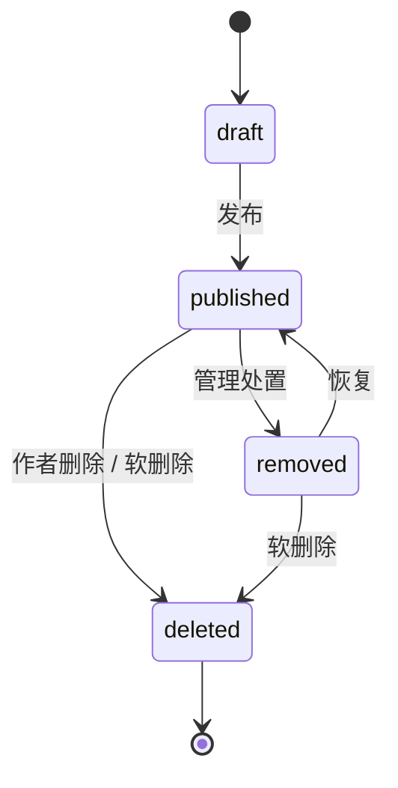

# 星聚 STARPAL · 产品需求文档（PRD）

| 项目 | 内容 |
| --- | --- |
| 产品 | 星聚 STARPAL（通用兴趣社区平台） |
| 版本 | v1.0.0 |
| 文档状态 | 基线（Baseline） |
| 文档类型 | 产品需求规格 |
| 关联文档 | [系统架构设计](./ARCHITECTURE.md) · [实施计划](./IMPLEMENTATION-PLAN.md) · [部署与配置指南](./DEPLOYMENT.md) |

> 品牌标识：**星聚 / STARPAL / SP**
> 主标语：让兴趣相遇，让热爱聚集。
> 英文标语：Where Interests Meet, Communities Grow.

---

## 1. 文档说明

### 1.1 目的

本文定义 v1.0 的产品边界、角色权限、功能需求、非功能需求与验收标准，作为设计、实现与验收的统一依据。架构实现见 [ARCHITECTURE.md](./ARCHITECTURE.md)，交付顺序见 [IMPLEMENTATION-PLAN.md](./IMPLEMENTATION-PLAN.md)。

### 1.2 范围

- **范围内**：Web 端社区平台（桌面 / 平板 / 移动端浏览器）、服务端 API、PostgreSQL 数据模型、管理后台、演示内容、导出能力、部署与配置文档。
- **范围外**：原生移动应用、联邦化互联、付费第三方服务、个性化推荐模型、实时消息推送。范围外项在 §9.2 统一登记，不计入 v1.0 交付范围。

### 1.3 读者

产品、前端、后端、测试、部署维护人员。

### 1.4 规范用语

| 用语 | 含义 |
| --- | --- |
| **须（MUST）** | 强制性要求，未满足视为未通过验收 |
| **应（SHOULD）** | 推荐要求，偏离时须在变更记录中说明 |
| **可（MAY）** | 可选实现，由实现阶段决定 |
| **不得（MUST NOT）** | 明确禁止 |

### 1.5 编号规则

| 前缀 | 含义 | 示例 |
| --- | --- | --- |
| `FR-` | 功能需求 | `FR-POST-03` |
| `NFR-` | 非功能需求 | `NFR-SEC-02` |
| `AC-` | 验收标准 | `AC-07` |
| `M#` | 里程碑，见实施计划 | `M3` |

需求编号在全生命周期内保持稳定；变更以版本化方式追加，不复用已删除编号。

### 1.6 术语表

| 术语 | 定义 |
| --- | --- |
| 话题（Topic） | 内容的分类容器，具有唯一 slug、双语名称与描述 |
| 帖子（Post） | 归属于单一话题的内容单元，由标题、正文与可选图片组成 |
| 信息流（Feed） | 按指定排序规则输出的帖子分页列表 |
| 游标分页 | 基于排序键的连续分页方式，不使用页码偏移 |
| 软删除 | 以状态位与删除时间标记记录，不物理移除行 |
| 审核日志 | 记录管理动作及其对象的只追加记录 |
| 演示内容 | 明确标注、用于开发期视觉验证的初始化数据 |
| 设计令牌 | 集中定义的颜色、字号、间距、圆角、阴影与模糊参数 |

---

## 2. 产品概述

### 2.1 定位

星聚 STARPAL 是一个以话题为核心组织方式的通用兴趣社区：成员围绕话题发布内容、阅读与讨论、收藏与检索、相互留言，并在明确的社区准则下完成内容治理。产品采用自有品牌与视觉语言，话题组织结构参考主流社区形态，不复用其品牌资产或代码实现。

### 2.2 核心价值

| 价值 | 产品落点 |
| --- | --- |
| 兴趣发现 | 话题发现页、话题详情、按话题筛选、热门与最新话题 |
| 社区互动 | 评论、点赞、收藏、私信、通知 |
| 知识分享 | 长文本内容、图片附件、帖子详情与相关帖子 |
| 创意表达 | 个人资料、头像、简介、成就记录 |
| 尊重沟通 | 社区准则、举报与审核流程、克制的交互与动效 |

### 2.3 运行形态与规模假设

- 部署形态：**单实例、单进程、单数据库**的自托管 Web 应用。
- 规模假设：小型社区，读多写少，并发量低。
- 成本约束：**不依赖任何付费第三方服务**；图片存储使用本地目录；全部功能可在通用自托管环境中运行。
- 平台形态：**响应式 Web 应用**，一套代码适配桌面、平板与移动端浏览器，不发布原生应用。

以上假设决定了排序策略、缓存策略与部署复杂度上限；规模假设变化时的演进路径见 [ARCHITECTURE.md §10](./ARCHITECTURE.md#10-扩展点设计)。

### 2.4 设计原则

1. 数据真实持久化，界面不得出现无后端支撑的交互控件或计数器。
2. 收集最小化：账户体系仅采集用户名与密码凭据，不采集手机号、邮箱或真实身份信息。
3. 隐私优先默认：可选资料默认不公开，敏感操作需显式确认。
4. 权限判定在服务端完成，前端隐藏控件不构成权限控制。
5. 视觉统一：全部页面复用同一套设计令牌与组件，玻璃效果仅用于导航层与浮层。
6. 数据可移植：全部用户内容须可导出为标准格式文件。

---

## 3. 角色与权限

### 3.1 角色定义

| 角色 | 标识 | 获取方式 |
| --- | --- | --- |
| 访客 | `anonymous` | 未建立会话 |
| 注册用户 | `user` | 通过注册流程创建；注册受邀请码约束 |
| 管理员 | `admin` | 由初始化脚本写入，**不提供公开注册入口** |

角色存储于服务端数据模型，随会话解析，不由客户端声明。

### 3.2 权限矩阵

| 能力 | 访客 | 注册用户 | 管理员 |
| --- | :---: | :---: | :---: |
| 浏览首页、话题、帖子详情 | ✓ | ✓ | ✓ |
| 搜索公开内容 | ✓ | ✓ | ✓ |
| 注册 / 登录 / 登出 | 仅注册登录 | 仅登出 | ✓ |
| 创建帖子、编辑与删除自己的帖子 | — | ✓ | ✓ |
| 点赞 / 取消点赞、收藏 / 取消收藏 | — | ✓ | ✓ |
| 发表评论、删除自己的评论 | — | ✓ | ✓ |
| 私信会话与消息 | — | ✓ | ✓ |
| 举报帖子 / 评论 / 行为 | — | ✓ | ✓ |
| 编辑自己的资料、导出自己的数据 | — | ✓ | ✓ |
| 查看脱敏后的公开审核记录 | ✓ | ✓ | ✓ |
| 编辑 / 移除他人内容 | — | — | ✓ |
| 话题创建、编辑、归档 | — | — | ✓ |
| 用户状态管理（停用 / 恢复） | — | — | ✓ |
| 举报复核、处置与关闭 | — | — | ✓ |
| 查看完整审核日志与后台统计 | — | — | ✓ |

> 公开审核记录仅包含动作类型、时间与对象类型，不含操作者标识与内部处置备注。

### 3.3 账户与隐私规则

| 编号 | 要求 |
| --- | --- |
| `FR-AUTH-00` | 注册表单须且仅须包含用户名、密码与邀请码三个输入项；邀请码由部署方分发，不属于采集的用户资料 |
| `FR-AUTH-01` | 用户名全局唯一、创建后不可修改；显示名默认等于用户名，可独立修改 |
| `FR-AUTH-02` | 密码不得以明文或可逆形式存储，须使用带盐的单向哈希 |
| `FR-AUTH-03` | 系统须提供隐私说明与社区准则页面，明确采集范围、存储位置、注销与数据删除方式 |
| `FR-AUTH-04` | 账号删除默认采用软删除，帖子保留并署名「已注销用户」；用户须可主动触发「彻底擦除我的数据」 |
| `FR-AUTH-05` | 认证失败提示须统一，不得区分「用户名不存在」与「密码错误」 |

---

## 4. 功能需求

### 4.1 导航与信息架构 `FR-NAV`

| 编号 | 需求 | 验收要点 |
| --- | --- | --- |
| `FR-NAV-01` | 主导航包含首页、发现、话题、发布、通知、我的六个目的地 | 六个入口均可达且指向已实现页面 |
| `FR-NAV-02` | 全局组件包含品牌标识、搜索栏、用户头像菜单、访客登录注册入口 | 桌面顶栏与移动端外壳均包含 |
| `FR-NAV-03` | 桌面端为三栏布局：左栏导航与话题分类、中栏信息流、右栏热门 / 公告 / 推荐 | ≥1280px 断点下三栏同时可见 |
| `FR-NAV-04` | 移动端使用底部四项 Tab：首页、发现、私信、我的；发布为中间凸起主操作 | <768px 断点下生效，触摸目标 ≥48px |
| `FR-NAV-05` | 话题入口在移动端并入「发现」；通知以顶栏图标 + 我的页入口呈现 | 目的地集合与桌面一致，不产生重复入口 |
| `FR-NAV-06` | 导航结构按断点折叠，不得在不同断点出现两套互相冲突的目的地定义 | 断点对照符合 [ARCHITECTURE.md §4.9](./ARCHITECTURE.md#49-响应式与无障碍实现约定) |

### 4.2 首页与信息流 `FR-FEED`

| 编号 | 需求 | 验收要点 |
| --- | --- | --- |
| `FR-FEED-01` | 信息流提供推荐、最新、热门三个 Tab | 三个 Tab 返回不同且可解释的排序结果 |
| `FR-FEED-02` | 帖子卡片展示作者头像、显示名、发布时间、话题、标题、正文预览、附图、点赞数、评论数、收藏与分享操作 | 字段齐全，缺失值有明确占位 |
| `FR-FEED-03` | 所有计数与操作须由服务端数据支撑；乐观更新失败须回滚并给出提示 | 断网或服务端错误时计数恢复原值 |
| `FR-FEED-04` | 采用游标分页或无限加载，提供骨架屏加载态、可重试错误态、带引导的空态 | 三种状态均可复现 |
| `FR-FEED-05` | 列表按 ID 去重，同一时刻仅保留一个在途请求；新内容以「有新帖」提示而非直接插入 | 快速翻页不出现重复或跳项 |
| `FR-FEED-06` | 从详情返回须恢复滚动位置 | 返回后位置与离开前一致 |
| `FR-FEED-07` | 右栏展示热门话题、社区公告与推荐内容；无数据时展示明确空态 | 不出现空白面板 |
| `FR-FEED-08` | 空状态文案指向创作行为，例如「这里还没有内容，第一篇由你写下」 | 无真实内容时显示 |

**排序规则（规范性定义）**

| Tab | 规则 |
| --- | --- |
| 最新 `Latest` | 按 `created_at` 降序 |
| 热门 `Popular` | 指定时间窗内按净赞数降序，辅以时间衰减 |
| 推荐 `Recommended` | 确定性加权：`w_topic × 话题亲和度 + w_freshness × 时间衰减 + w_hot × 热度分` |

热度分采用 `log10(max(净赞数, 1)) + 时间衰减项`。全部权重与衰减系数须集中定义于排序配置，**不得**散落于业务代码。v1.0 **不得**引入机器学习或用户行为画像；话题亲和度仅来自用户显式选择的话题。公式常量可在配置层调整，调整不影响 API 契约。

### 4.3 认证与会话 `FR-AUTH`

| 编号 | 需求 | 验收要点 |
| --- | --- | --- |
| `FR-AUTH-10` | 注册须在服务端校验用户名唯一性、长度与字符集、密码强度、邀请码有效性、请求体大小 | 非法输入被拒并返回可读错误 |
| `FR-AUTH-11` | 登录须校验凭据，并设置受保护会话 | 会话 Cookie 具备 `HttpOnly`、`SameSite`、生产环境 `Secure` 属性 |
| `FR-AUTH-12` | 登出须使服务端会话失效 | 失效后受保护接口返回未授权 |
| `FR-AUTH-13` | 受保护路由与 API 在服务端校验，未登录访问须被拒绝 | 直接请求 API 亦被拒绝 |
| `FR-AUTH-14` | 防批量注册采用分层策略：邀请码、应用层速率限制、蜜罐字段、登录失败限次、会话保护 | 各层独立可验证；蜜罐须避免屏幕阅读器误判 |
| `FR-AUTH-15` | 注册与登录须前置自托管人机验证（ALTCHA 工作量证明，无外部请求 / 无隐私采集）；一次性载荷服务端原子消费防重放 | 真人无感完成；无载荷 / 畸形 / 篡改 / 重放均被拒且错误一致；键由 `SESSION_SECRET` 派生，无新增配置 |
| `FR-AUTH-16` | 不得引入需外部账号、外部请求或付费的验证服务 | 无外部验证码依赖 |
| `FR-AUTH-17` | 初始管理员由初始化脚本结合环境变量创建，凭据不得写入代码仓库 | 仓库中不存在任何真实凭据 |

> 速率限制与登录失败计数须以不可逆摘要标识来源，并按期清理，不长期保留原始网络地址。

### 4.4 个人资料 `FR-PROF`

| 编号 | 需求 | 验收要点 |
| --- | --- | --- |
| `FR-PROF-01` | 公开个人页展示头像、显示名、用户名、简介、注册日期、已发布帖子 | 不展示密码哈希、会话、角色、网络地址等内部字段 |
| `FR-PROF-02` | 用户可编辑自己的显示名、头像与简介 | 仅本人可编辑 |
| `FR-PROF-03` | 个人页提供点赞、收藏、设置、关于、检查更新入口 | 入口均可达且有落地页面 |
| `FR-PROF-04` | 星座、MBTI、年龄为**选填**且**默认不公开**；年龄仅以年龄段呈现，不采集或展示生日 | 未显式公开时他方页面不可见 |
| `FR-PROF-05` | 可选资料字段与账户核心字段分离存储，新增展示字段不影响认证模块 | 见 [ARCHITECTURE.md §7.2](./ARCHITECTURE.md#72-实体关系) |
| `FR-PROF-06` | 设置页提供浅色 / 深色 / 跟随系统主题选择，并持久化用户选择 | 刷新后选择保留 |

### 4.5 帖子 `FR-POST`

| 编号 | 需求 | 验收要点 |
| --- | --- | --- |
| `FR-POST-01` | 用户可创建含标题、正文、话题归属的文本帖子，并可附加多张图片 | 提交后生成持久化记录 |
| `FR-POST-02` | 作者可编辑、删除自己的帖子；他人不得编辑或删除 | 越权请求被服务端拒绝 |
| `FR-POST-03` | 帖子详情页展示完整正文、作者信息、图片、话题信息、点赞操作、评论区、相关帖子 | 刷新后内容仍在 |
| `FR-POST-04` | 详情页须校验可见性：被移除或已删除的帖子不得公开展示 | 直接访问 ID 返回明确状态 |
| `FR-POST-05` | 标题与正文须在服务端校验长度、非空、内容类型 | 超长与空内容被拒 |
| `FR-POST-06` | 内容预览须在服务端生成或按统一规则截断，避免破坏结构与转义 | 预览不出现未转义标记 |

**帖子状态**

### 4.6 图片上传 `FR-IMG`

| 编号 | 需求 | 验收要点 |
| --- | --- | --- |
| `FR-IMG-01` | 服务端须校验文件类型，读取文件头魔术字节判定真实格式，不得信任文件名或客户端 `Content-Type` | 伪造扩展名与 MIME 的样例被拒 |
| `FR-IMG-02` | 大小限制须覆盖三层：请求体、上传中间件、应用逻辑；上传中间件须显式设置上限 | 超限被拒且不写入磁盘 |
| `FR-IMG-03` | 通过图像处理库重新编码生成全新文件；随机文件名；剥离元数据 | 上传后文件不含原始 EXIF / 定位信息 |
| `FR-IMG-04` | 图片二进制与元数据均入库（`image_blobs` / `post_images`），不写宿主磁盘；数据库仅保存随机键、MIME、宽高、字节数、排序 | 实例重建后图片仍可读取；不存在「库在文件丢」 |
| `FR-IMG-05` | 图片响应须携带禁止类型嗅探的响应头 | 响应头存在 |
| `FR-IMG-06` | 前端须预留宽高比、懒加载、提供 `alt` 文本，并按断点缩放 | 无布局抖动、无横向溢出 |
| `FR-IMG-07` | 删除帖子或移除图片时须同步清理存储引用与文件 | 无孤儿文件 |

### 4.7 互动：点赞、收藏、评论 `FR-INT`

| 编号 | 需求 | 验收要点 |
| --- | --- | --- |
| `FR-INT-01` | 点赞 / 取消点赞须持久化且计数准确，同一用户对同一帖子仅可点赞一次 | 数据库唯一约束生效，并发重复请求不产生重复记录 |
| `FR-INT-02` | 收藏 / 取消收藏须持久化且不可重复 | 同上 |
| `FR-INT-03` | 评论按时间顺序展示，用户可删除自己的评论，管理员可移除任意评论 | 删除后列表正确刷新 |
| `FR-INT-04` | 评论内容须在服务端校验长度与转义；正文 1–2000 字符，按 Unicode 码点计（emoji 算 1） | 空评论、纯空白、超 2000 字符与非法 Unicode 被拒 |
| `FR-INT-05` | 评论区按**时间倒序**（最新在上）；v1 不开放评论点赞，`comments.like_count` 保留但恒为 0。「赞数与时间综合排序」需先有评论点赞，顺延至后续版本 | 排序可解释：新评论始终在顶部，不存在首条霸榜 |
| `FR-INT-06` | 互动计数须在事务内维护，禁止仅前端累加 | 刷新后计数与数据库一致 |
| `FR-INT-07` | v1.0 评论为单层结构，不实现嵌套回复 | 界面不出现无功能的回复入口 |

### 4.8 话题与发现 `FR-TOPIC`

| 编号 | 需求 | 验收要点 |
| --- | --- | --- |
| `FR-TOPIC-01` | 内置九个话题分类，具备唯一 slug、中文名、英文名与描述 | 初始化迁移后可直接查询 |
| `FR-TOPIC-02` | 话题发现页展示全部话题、热门话题与最新话题 | 三个视图均有数据或明确空态 |
| `FR-TOPIC-03` | 话题详情页展示描述并按该话题筛选帖子 | 筛选结果仅包含该话题 |
| `FR-TOPIC-04` | 管理员可创建、编辑、归档话题 | 操作写入审核日志 |
| `FR-TOPIC-05` | 每周热门内容以只读聚合方式挂在话题页，不建立实时排名写表 | 刷新可见，不产生额外写入 |

**内置分类**

| slug | 中文名 | 英文名 |
| --- | --- | --- |
| `technology` | 科技数码 | Technology & Digital |
| `gaming` | 游戏 | Gaming |
| `anime` | 动漫文化 | Anime & Culture |
| `learning` | 学习成长 | Learning & Education |
| `lifestyle` | 生活 | Lifestyle |
| `creative` | 创作艺术 | Creative Arts |
| `science` | 科学 | Science |
| `sports` | 运动 | Sports |
| `other` | 其他兴趣 | Other Interests |

### 4.9 私信 `FR-MSG`

| 编号 | 需求 | 验收要点 |
| --- | --- | --- |
| `FR-MSG-01` | 提供会话列表与消息列表，支持发起会话与发送文本消息 | 消息真实持久化，刷新后可见 |
| `FR-MSG-02` | 会话按最后消息时间排序，同一对用户仅存在一个会话 | 唯一性约束生效 |
| `FR-MSG-03` | 消息仅会话参与者可见 | 越权访问被拒 |
| `FR-MSG-04` | v1.0 采用留言式交互，**不实现实时推送**；数据模型须一次建到位，后续接入推送不改表结构 | 见 [ARCHITECTURE.md §10](./ARCHITECTURE.md#10-扩展点设计) |
| `FR-MSG-05` | 发送内容须在服务端校验长度与转义 | 非法内容被拒 |

### 4.10 成就与激励 `FR-ACH`

> **实现状态（2026-11-15）**：本节已按最小可用形态落地（迁移 `014_achievements.sql`，见 `VR-M5-S2-01`）。`FR-ACH-01`：条件存于 `achievements.condition`（`{"metric","gte"}`），判定引擎只认「单指标 + 阈值」，新增成就只插一行数据。`FR-ACH-02`：`user_achievements` 复合主键保证一次性解锁，时间线按解锁时间倒序呈现。`FR-ACH-03`：每周热门为服务层只读聚合，不建视图、不落表、无定时任务。`FR-ACH-04`：界面无排行榜（热门只排帖子不排人）、无签到、无无限滚动、无「还差 X 个」进度百分比。**已知语义偏差**：解锁时间记录的是「判定时刻」而非行为发生瞬间（读时判定的代价），对外文案如实写作「解锁于某日」；已解锁成就不会因条件回退（如撤赞）而收回。

| 编号 | 需求 | 验收要点 |
| --- | --- | --- |
| `FR-ACH-01` | 称号由可累积行为解锁，规则以数据形式定义，不硬编码于业务逻辑 | 新增称号无须改动业务代码 |
| `FR-ACH-02` | 以成就时间线呈现解锁记录，同一成就对同一用户仅解锁一次 | 唯一性约束生效 |
| `FR-ACH-03` | 每周热门为按周聚合的只读视图 | 不产生定时写任务 |
| `FR-ACH-04` | **不得**实现实时排行榜、连续签到、无限滚动等成瘾式机制 | 界面不存在相关控件 |
| `FR-ACH-05` | 成员等级由累计参与派生（`L1`–`L50`），按区间标注段位；等级只升不降，不展示排名与升级进度 | 界面无等级排行与进度条；删帖不掉级 |
| `FR-ACH-06` | 段位徽标可由成员自行佩戴：等级到过的段位永久解锁，可随时更换或隐藏；只在公开个人主页显示，不进帖子与评论署名行 | 未解锁段位无法佩戴；摘下后主页不显示；署名行不出现段位 |

> **等级与段位（`FR-ACH-05`，2026-11-15，`M5.5-S2`）**：经验由 `shared/metrics.ts` 的七个指标加权现算，不建经验流水表、不给写入链路加累加点；等级取 `max(现算等级, users.top_level)`，晋级时把 `top_level` 抬上去（迁移 `019_user_level.sql`）。段位五档：`L1`–`10` 萌新、`11`–`20` 入门、`21`–`30` 常客、`31`–`40` 老友、`41`–`50` 元老。**「头衔」一词专指站长身份**（`users.titles`：社区长 / 创始人 / 管理员），段位不叫头衔，避免两种东西共用一个词。
>
> **刻意不做的三件**：① **不展示升级进度**（无进度条、无「还差 X 经验」）——精确追踪会变成催促，越界到 `FR-ACH-04`；② **不做等级排行**，等级只出现在两处——公开个人页（`/u/:username`），以及底栏「我的」落地的设置页顶部（该页指向 `/settings` 而非个人页，不放这里用户找不到）；段位徽标（`FR-ACH-06`）可另行佩戴在个人页名字旁，帖子与评论署名行一律不显示等级与段位；③ **不做签到**，`FR-ACH-04` 与 §11 排除项已明确禁止连续签到，本节不另开例外。经验权重与封顶（话题最多 5 个、加入天数最多 100 天、私信不计分）见 `server/src/modules/levels/level.rules.ts`，改动需同步 `level-rules.test.ts` 的期望值。

> **段位徽标（`FR-ACH-06`，2026-11-15）**：`users.equipped_rank`（迁移 `021_user_rank_badge.sql`）只存「戴哪一个」，`NULL` 表示不戴。**「已解锁哪些」不落库**——等级只升不降，`top_level` 就是历史最高，到过的段位天然永久可用；再建一张解锁表就要在每次晋级时同步写入，多一处可能与 `top_level` 分叉的真源。佩戴值若因历史脏数据落在未解锁区间，读路径按「没戴」处理：宁可少一个徽标，也不挂出用户还没资格拥有的段位。默认不戴，由成员自己在设置里开——一注册就顶着「萌新」是替人贴标签。
>
> **为什么徽标不进署名行**（与 `FR-ACH-04` 同一条底线）：署名行是高频曝光位，一屏主题列表每条作者旁都挂段位，等于给整个社区排了一遍序；而「头衔」已经是权限身份（社区长 / 创始人 / 管理员）并在署名行显示，两者并排会让读者分不清哪个是权力、哪个是资历。这与 Discourse 的处理一致——信任等级只进个人资料与用户卡，帖子署名只放可选 title。

### 4.11 通知、搜索、导出 `FR-AUX`

| 编号 | 需求 | 验收要点 |
| --- | --- | --- |
| `FR-AUX-01` | 评论、点赞、被提及、私信与系统公告生成通知，支持已读标记 | 通知计数与列表一致 |
| `FR-AUX-02` | 搜索覆盖帖子标题、正文与话题名称，支持类型过滤与分页 | 结果与权限范围内可见内容一致 |
| `FR-AUX-03` | 用户须可导出自己的全部内容为 Markdown 与 JSON 标准文件 | 导出文件可被外部工具读取 |
| `FR-AUX-04` | 导出须包含帖子、评论、图片引用与资料字段，且不含其他用户数据 | 内容边界明确 |
| `FR-AUX-05` | 关于页展示版本信息与建站日期，检查更新入口给出明确状态 | 不出现无响应按钮 |

> **实现状态（2026-11-15，M5 收尾）**：`FR-AUX-02`（搜索）、`FR-AUX-03` / `FR-AUX-04`（导出）、`FR-AUX-05`（关于页）已满足。`FR-AUX-01` **按 1/5 交付并明确收窄**，见下方偏差。
>
> **已知范围偏差（`FR-AUX-01`）**：需求原文要求「评论、点赞、被提及、私信与系统公告」五类均生成通知，实际只实现**评论**一类。通知表约束（`005_interactions.sql` 的 `notifications_type_valid`）已放行 `like` / `mention` / `message` / `system`，说明设计意图是全做；缺的是写入侧——`notifications` 目前只有 `comment.repository.ts` 一处产生。其余四类不做，各有具体理由：
>
> | 类型 | 结论 | 理由 |
> | --- | --- | --- |
> | 点赞 | 不做 | 高频写路径；热门帖会把作者的通知列表刷满，沦为噪音。当前社区规模下「被赞」的情感回报低于打扰成本 |
> | 私信 | 不做 | 每条消息一条通知，一次对话即产生数十条；私信本身有会话列表与时间排序，用户主动查看的路径已存在 |
> | 系统公告 | 不做 | 公告已在右栏卡片与 `/announcements` 页常驻可见，再推一遍属重复打扰 |
> | 被提及 | 不适用 | 站内**没有 `@` 提及功能**，不存在可触发的场景；若将来加入提及，须同步恢复本条 |
>
> 该收窄已对外披露：站内「当前进度与已知问题」公告正文明确写出「通知只在你收到评论时发出」，迁移 `017_status_announcement_scope.sql` 落地。若后续要做点赞通知，需同步改动四处：写入侧（`interaction.repository.ts`）、列表投影（`notification.repository.ts` 的 `LIST_SELECT` 目前只按 `target_type='comment'` 关联）、前端文案（`NotificationsPage.tsx` 的 `describe`）以及防刷屏的唯一索引。

### 4.12 举报与内容治理 `FR-REPORT`

> **实现状态（2026-11-16 更新）**：`FR-REPORT-01`（仅帖子 / 评论目标，「不当行为」独立举报的 `user` 目标类型已在迁移 `022` 数据层支持，服务层未启用）、`FR-REPORT-02`、`FR-REPORT-05` 已满足。`FR-REPORT-03` 的内容处置（移除帖子 / 评论、停用账号）与审核日志已在 M6 步 2–3 落地（见 `VR-M6-01`），§4.13 的六分区后台与统计已交付。**举报队列本身仍只标记「已处理 / 已驳回」并写答复，不自动移除内容或停用账号**——运营者在治理后台单独执行处置。下方四态状态机为规划口径；实际落地的只有 `pending` / `resolved` / `dismissed` 三态，`reviewing` 数据层已就绪但服务层 / 界面未启用。

| 编号 | 需求 | 验收要点 |
| --- | --- | --- |
| `FR-REPORT-01` | 注册用户可举报帖子、评论或不当行为，须选择原因并可附说明 | 举报生成待处理记录 |
| `FR-REPORT-02` | 举报目标须在服务端校验存在性与可见性 | 伪造目标 ID 被拒 |
| `FR-REPORT-03` | 管理员可查看举报、复核内容、驳回、移除违规内容、停用账号 | 每个动作产生审核日志 |
| `FR-REPORT-04` | 处置须可追溯：保留动作类型、时间、对象与处置结果 | 日志只追加、不覆盖 |
| `FR-REPORT-05` | 系统须提供可访问的社区准则，列明禁止行为、处置方式与申诉路径 | 准则页面可达 |

**举报状态**

| 状态 | 含义 | 允许的下一状态 |
| --- | --- | --- |
| `pending` | 待处理 | `reviewing` / `dismissed` |
| `reviewing` | 复核中 | `resolved` / `dismissed` |
| `resolved` | 已处置 | 终态 |
| `dismissed` | 已驳回 | 终态 |

### 4.13 管理后台 `FR-ADMIN`

| 编号 | 需求 | 验收要点 |
| --- | --- | --- |
| `FR-ADMIN-01` | 提供独立后台，包含用户、帖子、评论、话题、举报与统计六个分区 | 分区均可达 |
| `FR-ADMIN-02` | 所有管理 API 在服务端校验角色，普通用户请求须被拒绝 | 绕过前端直接调用亦被拒 |
| `FR-ADMIN-03` | 用户管理支持查看、停用与恢复；不得提供公开管理员注册 | 角色提升无公开入口 |
| `FR-ADMIN-04` | 评论审核支持列表、移除与恢复 | 操作写入日志 |
| `FR-ADMIN-05` | 统计以基础指标为主（用户数、帖子数、评论数、待处理举报数），以数值卡片与简易条形呈现 | 不引入图表库依赖 |
| `FR-ADMIN-06` | 重要管理动作须写入 `moderation_logs`，并按租户可见性脱敏公开 | 日志不可被普通用户改写 |

> **实现状态（2026-11-16）**：`FR-ADMIN-01`–`04`、`FR-ADMIN-06` 已交付（见 `VR-M6-01` / `VR-M6-02`）。两处**范围偏差如实登记**：① `FR-ADMIN-05` 只做了**数值卡片**，未做「简易条形」——四个数字用卡片已足够表达，条形需额外布局且无对比维度，属过度设计；② `FR-ADMIN-06` 的脱敏视图 `moderation_public_log` 已建，但**没有公开读取端点**——「公开审核记录」能力在数据层就绪、接口层未提供，避免把内部治理动作暴露给匿名访客，待产品确认公开口径后再接端点。六分区中的「举报」复用既有管理队列页面、「公告」复用 M6-S0 页面，均纳入统一导航。

---

## 5. 非功能需求

### 5.1 视觉设计系统 `NFR-VIS`

| 编号 | 要求 |
| --- | --- |
| `NFR-VIS-01` | 建立统一设计令牌，作为颜色、字号、间距、圆角、阴影与模糊参数的唯一来源 |
| `NFR-VIS-02` | 浅色主题以暖白与中性灰为底，深色主题以午夜蓝与炭黑为底，强调色为低饱和星蓝紫；正文与背景须满足对比度要求 |
| `NFR-VIS-03` | 半透明磨砂玻璃仅用于导航栏、浮层、下拉与模态框；内容卡片保持实色高可读 |
| `NFR-VIS-04` | 玻璃层参考参数：`rgba(255,255,255,0.85)` + `backdrop-filter: blur(12px)` + 1px 细边框 + 低对比阴影；玻璃层不得降低文字对比度 |
| `NFR-VIS-05` | 字体采用现代无衬线族，配置中文与英文回退；建立统一字号阶梯与行高 |
| `NFR-VIS-06` | 明确禁止：过度渐变、霓虹色、发光边框、随机装饰圆、过度圆角、过量透明、无意义浮动元素、页面风格不一致、通用仪表盘模板布局 |
| `NFR-VIS-07` | 动效限于轻微悬停、平滑过渡与克制入场；hover 不得作为唯一交互入口 |
| `NFR-VIS-08` | 品牌标识为几何化中心主星 + 环绕小星，提供单色与深浅两套，缩放至 favicon 尺寸仍可辨识；全站品牌命名统一 |

**设计令牌分组（参考基线，实现以令牌文件为准）**

| 分组 | 令牌示例 | 说明 |
| --- | --- | --- |
| 颜色 | `--bg-surface` / `--bg-subtle` / `--text-primary` / `--text-muted` / `--accent` / `--border` | 浅深两套同名令牌，主题切换仅切换取值 |
| 字号 | `--text-xs` … `--text-2xl` | 固定阶梯，页面不得使用阶梯外字面量 |
| 间距 | `--space-1` … `--space-10` | 4px 基准的等比序列 |
| 圆角 | `--radius-sm` / `--radius-md` / `--radius-lg` | 数值克制，卡片不使用超大圆角 |
| 效果 | `--glass-bg` / `--glass-blur` / `--shadow-low` / `--border-hairline` | 玻璃与阴影统一收敛 |

### 5.2 响应式 `NFR-RWD`

| 断点 | 布局 |
| --- | --- |
| ≥1280px | 三栏：左栏展开 + 中栏信息流 + 右栏停靠 |
| 1024–1279px | 左栏收为图标轨，右栏改浮层 |
| 768–1023px | 左栏变抽屉，三栏降两栏 |
| <768px | 底部 Tab（4 项 + 中央发布），详情为整屏 |

- 帖子卡片、图片、表单与对话框须随断点重排；页面不得出现横向溢出。
- 移动端触摸目标不小于 48px；底部栏须避让系统手势区。
- 正文阅读宽度控制在 65–75 字符区间。

### 5.3 无障碍 `NFR-A11Y`

| 编号 | 要求 |
| --- | --- |
| `NFR-A11Y-01` | 使用语义化 HTML；信息流容器具备 `role="feed"`，条目具备 `role="article"` 及位置与总数属性 |
| `NFR-A11Y-02` | 支持条目间键盘导航（Page Up / Page Down / Home / End）与可见焦点态 |
| `NFR-A11Y-03` | 全部表单控件具备可访问标签；对话框具备焦点管理与关闭路径 |
| `NFR-A11Y-04` | 文本与背景对比度满足 WCAG AA；图片提供 `alt` |
| `NFR-A11Y-05` | 蜜罐字段须以不影响辅助技术的方式实现，避免误伤正常用户 |

### 5.4 状态、性能与可靠性 `NFR-OPS`

| 编号 | 要求 |
| --- | --- |
| `NFR-OPS-01` | 所有异步视图须提供加载（骨架屏）、错误（可重试）、空（引导式）三态 |
| `NFR-OPS-02` | 列表须分页；图片懒加载并预留尺寸；避免 N+1 查询与不必要的数据库往返 |
| `NFR-OPS-03` | 应用外壳与骨架先绘制，不得整页阻塞转圈 |
| `NFR-OPS-04` | 错误信息须可读且不包含堆栈、SQL 或内部路径 |
| `NFR-OPS-05` | 关联写操作须使用数据库事务；计数与明细须一致 |
| `NFR-OPS-06` | 配置通过环境变量注入；不得在代码仓库中包含真实凭据、密钥或邀请码 |
| `NFR-OPS-07` | 日志须结构化，记录请求标识、时间、路径、状态与耗时，不记录密码与完整凭据 |

### 5.5 安全 `NFR-SEC`

| 编号 | 要求 |
| --- | --- |
| `NFR-SEC-01` | 密码使用带盐单向哈希；凭据比较在服务端完成 |
| `NFR-SEC-02` | 全部输入在服务端校验；输出按上下文转义 |
| `NFR-SEC-03` | 会话受保护，具备失效与过期机制；管理端点独立鉴权 |
| `NFR-SEC-04` | 上传校验不依赖客户端；文件重编码；目录无执行权限；禁止类型嗅探 |
| `NFR-SEC-05` | 请求体大小、速率与登录失败次数均有限制 |
| `NFR-SEC-06` | 安全响应头、同源策略、Cookie 属性按部署环境启用 |
| `NFR-SEC-07` | 错误信息不泄露账户存在性与内部实现 |
| `NFR-SEC-08` | 重要管理动作只追加记录，不可被普通用户改写 |

### 5.6 可移植性与内容策略 `NFR-DATA`

| 编号 | 要求 |
| --- | --- |
| `NFR-DATA-01` | 用户内容须可导出为 Markdown / JSON，避免与特定运行环境绑定 |
| `NFR-DATA-02` | 数据库结构变更须通过版本化迁移执行，支持初始化与回滚说明 |
| `NFR-DATA-03` | 演示话题与示例帖须统一标注「示例」，不得伪装为真实成员产出的内容 |
| `NFR-DATA-04` | 无真实内容时各页面展示对应空态，不以演示内容冒充社区活跃度 |
| `NFR-DATA-05` | 备份与恢复流程须文档化，且不依赖付费服务 |

---

## 6. 业务实体与规则

> 本节仅定义**业务实体与业务规则**；物理表结构、字段类型、索引与迁移见 [ARCHITECTURE.md §7](./ARCHITECTURE.md#7-数据架构)。

| 实体 | 关键业务属性 | 主要规则 |
| --- | --- | --- |
| 用户 | 用户名、显示名、凭据哈希、角色、状态、注册时间 | 用户名唯一且不可改；状态含正常 / 停用 / 已注销 |
| 资料 | 头像、简介、星座、MBTI、年龄段、可见性 | 与账户核心分离；可选字段默认不公开 |
| 话题 | slug、双语名称、描述、排序、演示标记 | slug 唯一；归档为软删除 |
| 帖子 | 作者、话题、标题、正文、状态、计数、时间 | 归属单一话题；软删除 |
| 图片 | 帖子、存储引用、MIME、宽高、字节数、排序 | 与数据库分离存储；仅存元数据与引用 |
| 点赞 / 收藏 | 用户、帖子、时间 | 同一用户对同一帖子唯一 |
| 评论 | 帖子、作者、正文、状态、时间 | 单层；作者与管理员可移除 |
| 会话 / 消息 | 参与者、正文、已读、时间 | 同一用户对唯一会话；仅参与者可见 |
| 通知 | 接收者、类型、来源、目标、已读、时间 | 由互动事件生成 |
| 成就 | 编码、名称、条件、解锁记录 | 条件数据化；同一用户对同一成就唯一 |
| 举报 | 举报人、目标类型与 ID、原因、状态、处置 | 目标须经服务端校验 |
| 审核日志 | 操作者、动作、目标、元数据、时间 | 只追加 |
| 安全事件 | 类型、来源摘要、时间 | 仅存不可逆摘要，按保留期清理 |

---

## 7. 验收标准

| 编号 | 验收项 | 判定依据 | 关联需求 |
| --- | --- | --- | --- |
| `AC-01` | 注册产生真实数据库记录 | 查询用户表可得到新行，密码字段为哈希 | `FR-AUTH-10` |
| `AC-02` | 登录与登出可用 | 登出后受保护接口返回未授权 | `FR-AUTH-11/12/13` |
| `AC-03` | 密码不以明文存储 | 数据库与日志均无明文凭据 | `NFR-SEC-01` |
| `AC-04` | 用户可创建帖子 | 提交后信息流与详情页可见 | `FR-POST-01` |
| `AC-05` | 帖子刷新后仍存在 | 重新加载页面内容不变 | `FR-POST-03` |
| `AC-06` | 图片上传可用且校验有效 | 合法图片成功；伪造类型 / 超限 / 含元数据被拒或净化 | `FR-IMG-01…03` |
| `AC-07` | 点赞持久化且不可重复 | 唯一约束生效，刷新后计数准确 | `FR-INT-01` |
| `AC-08` | 评论持久化并正确展示 | 按时间序展示，删除后同步 | `FR-INT-03` |
| `AC-09` | 话题筛选生效 | 筛选结果仅含目标话题 | `FR-TOPIC-03` |
| `AC-10` | 用户可编辑自己的资料 | 修改生效，他人不可编辑 | `FR-PROF-02` |
| `AC-11` | 普通用户无法访问管理端点 | 直接调用管理 API 被拒 | `FR-ADMIN-02` |
| `AC-12` | 管理员可处置内容并留痕 | 处置生效且产生审核日志 | `FR-REPORT-03/04` |
| `AC-13` | 移动端布局可用 | 三个移动断点下无横向溢出、控件可用 | `NFR-RWD` |
| `AC-14` | 全站视觉一致 | 各页面复用同一令牌与组件，无风格分叉 | `NFR-VIS-01/06` |
| `AC-15` | 三态完备 | 加载 / 错误 / 空态均可复现 | `NFR-OPS-01` |
| `AC-16` | 数据可导出 | 导出文件包含本人全部内容且可被外部读取 | `FR-AUX-03/04` |
| `AC-17` | 演示内容标注清晰 | 示例内容带统一标记，空态不被掩盖 | `NFR-DATA-03/04` |
| `AC-18` | 仓库不含真实凭据 | 全仓库扫描无密钥、口令与邀请码明文 | `NFR-OPS-06` |

> 每项验收须附实际执行的命令与输出；未执行的项标记为「未验证」，不得以推定结论代替。

---

## 8. 依赖与前置条件

| 类别 | 内容 |
| --- | --- |
| 运行时 | Node.js 22 LTS、npm |
| 数据库 | PostgreSQL，连接信息由环境变量提供 |
| 存储 | PostgreSQL（图片二进制存 `BYTEA`，见架构 `ADR-014`），不依赖本地磁盘或对象存储 |
| 构建 | 前端构建产物由服务端进程托管 |
| 配置 | 会话密钥、数据库连接串、邀请码、上传大小上限、初始管理员凭据 |
| 文档 | [部署与配置指南](./DEPLOYMENT.md)、数据库迁移说明、环境变量清单 |

---

## 9. 版本边界

### 9.1 v1.0 交付范围

- 六项主导航、三栏 / 底部 Tab 响应式外壳与统一设计系统
- 注册、登录、登出、会话、受保护路由、资料编辑、隐私与准则页面
- 帖子创建 / 编辑 / 删除 / 详情、图片上传、九类话题与筛选
- 点赞、收藏、评论、通知、留言式私信、成就时间线与每周热门
- 举报、管理后台、服务端角色校验、审核日志、基础统计
- 搜索、数据导出、演示内容、空态与错误态
- 完整源码、迁移、环境变量文档、启动与配置说明、已实现与待配置清单、已知限制

### 9.2 明确排除或后置

| 项目 | 处理 | 原因 |
| --- | --- | --- |
| 个性化推荐模型 / 行为画像 | 排除 | 小规模数据下无有效增益，成本与复杂度不匹配 |
| 实时私信推送 | 后置 | 数据模型一次建到位，后续新增推送模块不改表 |
| 实时排行榜、连续签到、无限滚动 | 排除 | 与克制、尊重的产品原则冲突 |
| 嵌套评论 / 楼中楼 | 后置 | v1.0 保持单层，避免界面与查询提前复杂化 |
| 第三方人机验证 / 外部验证码 | 排除 | 引入外部依赖与隐私成本；改以自托管 ALTCHA 落地人机验证（`FR-AUTH-15`） |
| 对象存储、CDN、Redis、消息队列、多容器编排 | 排除 | 单实例规模下无必要 |
| 原生移动应用、应用商店发布 | 排除 | 响应式 Web 已覆盖两端 |
| 联邦化互联、多站点 | 排除 | 超出 v1.0 边界 |
| 全文检索引擎、SSR / SEO 体系 | 排除 | 需求不依赖搜索引擎收录 |

---

## 10. 已知限制与风险

| 编号 | 限制 / 风险 | 影响 | 缓解措施 |
| --- | --- | --- | --- |
| `R-01` | 单进程单实例，不具备水平扩展能力 | 规模增长后需改造 | 会话与限流数据持久化、存储层接口化，见架构 §10 |
| `R-02` | 图片二进制占用数据库免费额度（Neon 免费层每项目 1 GB） | 图片总量接近上限后写入失败 | 服务端重编码压至约 200 KB/张；总量超 500 MB 时按架构 §8.4 迁移至对象存储 |
| `R-03` | 无联系方式的注册体系无法彻底阻断自动化批量注册 | 存在被刷风险 | 邀请码 + 限流 + 蜜罐 + 失败限次的纵深策略；目标为提高自动化成本 |
| `R-04` | 留言式私信不具备即时性 | 需刷新才能看到新消息 | 明确产品预期；后续接入推送模块 |
| `R-05` | 排序权重为人工配置，无自适应能力 | 内容增长后排序质量可能下降 | 权重集中配置，替换排序策略不影响 API 契约 |
| `R-06` | 演示内容与真实内容共存 | 可能干扰观感判断 | 统一「示例」标记与独立空态 |
| `R-07` | 基础统计不含时序分析 | 运营分析能力有限 | 数据可导出，后续按需扩展 |

---

## 11. 需求追踪矩阵

| 里程碑 | 覆盖需求 | 关联验收 |
| --- | --- | --- |
| `M1` 骨架与设计系统 | `FR-NAV-01…06`、`NFR-VIS-*`、`NFR-RWD` | `AC-13`、`AC-14` |
| `M2` 认证与账户 | `FR-AUTH-*`、`FR-PROF-01…06` | `AC-01/02/03/10` |
| `M3` 内容与话题 | `FR-POST-*`、`FR-IMG-*`、`FR-TOPIC-*` | `AC-04/05/06/09` |
| `M4` 互动 | `FR-INT-*` | `AC-07/08` |
| `M5` 私信 / 成就 / 辅助 | `FR-MSG-*`、`FR-ACH-*`、`FR-AUX-*` | `AC-16` |
| `M6` 治理 | `FR-REPORT-*`、`FR-ADMIN-*` | `AC-11/12` |
| `M7` 收尾 | `NFR-OPS-*`、`NFR-SEC-*`、`NFR-A11Y-*`、`NFR-DATA-*` | `AC-15/17/18` |

---

## 12. 变更控制

1. v1.0 基线冻结后，功能增删须以文档版本递增方式记录，并同步更新追踪矩阵与验收标准。
2. 涉及数据库结构的变更须新增迁移文件，不得修改已执行的迁移。
3. 涉及不可逆环境的动作（公开部署、外部账号注册、数据清除、既有代码覆盖）须单独审批后执行。
4. 代码与 `README` / `CHANGELOG` 须同步更新。
