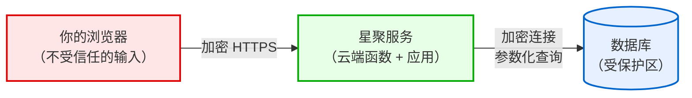

# 星聚 STARPAL · 安全设计说明（对外版）

> 性质：面向社区成员的安全设计概览　版本：v1.7.0　日期：2026-11-18
> 这份文档用通俗语言说明：星聚面临哪些安全与隐私风险、我们做了哪些防护。
> 完整的技术分析见内部文档 `docs/THREAT-MODEL.md`（含源码级证据，不对外）。
> 许可：CC BY-NC-SA 4.0（见 `LICENSE-docs`）

---

## 写在前面：我们怎么看待安全

星聚是一个**邀请制、非商业、小规模**的兴趣社区，这里没有支付、没有金钱交易。但我们依然认真对待每一位成员的数据和体验。这份说明回答四个问题：

1. 我们在保护什么？
2. 可能出什么问题？
3. 我们怎么防？
4. 我们坦诚说明哪些还做不到。

我们的分析方法遵循业内通行的做法（OWASP 威胁建模框架），从六个角度系统梳理风险：**冒充他人、篡改数据、抵赖、信息泄露、服务瘫痪、越权**。

---

## 一、我们怎么设计数据流向

简单说，你的数据只经过三道信任区域：

- **你的浏览器 → 星聚服务**：全程 HTTPS 加密。发送的内容会在服务端严格检查。
- **星聚服务 → 数据库**：用参数化方式查询（一种防注入的标准做法），数据加密存储于传输中。
- **我们不用任何第三方账号或接口**：人机验证、头像生成都在我们自己的服务器上完成，**不把你的访问信息交给外部公司**。

---

## 二、我们保护什么

| 数据 | 我们怎么保护 |
| --- | --- |
| 你的密码 | 用 Argon2id（业内推荐的慢哈希算法）单向加密存储，**我们自己也看不到明文** |
| 登录状态 | 用随机凭证 + 浏览器安全 Cookie（HttpOnly / Secure），登录时新建、退出即销毁 |
| 邀请码 | 只存不可逆的摘要，明文只在生成时显示一次 |
| 你的私信 | 仅对话双方可见，服务端会校验身份；传输全程加密 |
| 你的帖子与资料 | 只有作者和管理员能改动，别人无法越权 |
| 上传的图片 | 只接受常见图片格式，系统会重新编码处理，剥离隐藏信息 |

---

## 三、我们怎么防（六个角度）

### 防止冒充他人
- 注册和登录都有一道**人机验证**（自托管的工作量证明，真人几乎无感，机器要付出计算成本）。
- 密码用强算法保护；连续登录失败会临时锁定。
- 登录状态用不可猜测的随机凭证，且是"安全 Cookie"——网页脚本读不到，跨站也带不走。

### 防止篡改数据
- 你的帖子、评论、资料，**只有你自己或管理员能改**，系统会逐一核对身份。
- 所有数据库查询都用参数化方式，从根上堵住注入攻击。
- 上传的图片会检查真实格式（不看文件后缀）、限制大小和像素、重新编码，恶意文件进不来。

### 防止抵赖、留不下痕迹
- 每个请求都有编号并记入日志，关键操作（如举报、审核）会落库留痕，便于追溯。

### 防止信息泄露
- 出错时只给一句笼统提示，不会把系统内部细节暴露给外部。
- 一套严格的浏览器安全策略（CSP 等）防止恶意脚本注入。
- 私密内容（私信、"我的举报"、导出）严格按身份过滤，改链接 ID 也看不到别人的。
- 密码、邀请码都以不可逆形式存储；系统密钥通过环境变量注入，不写进代码。

### 防止服务瘫痪
- 发布、评论、举报、上传等写操作都有频率限制，防止刷屏灌水。
- 上传有大小和像素上限，防止超大文件耗尽资源。
- 人机验证抬高自动化攻击的成本。

### 防止越权
- 权限只有普通用户和管理员两种。**展示用的头衔不等于权限**。
- 所有管理功能都先校验登录 + 管理员身份，服务端层层把关，不是靠前端藏按钮。
- 没有公开的管理员注册入口。

---

## 四、我们坦诚说明的边界

我们不愿意把话说满。以下是当前**做不到或尚未做**的部分：

- **未经第三方安全审计**：这份说明是我们基于代码的自我分析，不是独立机构的安全认证。我们不建议把星聚用于存放高度敏感的信息。
- **无法彻底阻挡批量注册**：邀请码 + 人机验证能挡住绝大多数自动化注册，但对有耐心的攻击者没有绝对办法。
- **私信内容以明文存于数据库**：靠访问控制和加密传输保护。如果数据库整体失陷，私信内容理论上可读。
- **部分操作无频率限制**：例如私信发送，登录后仍可能被用于刷屏骚扰，我们把它列为后续改进项。
- **未做外部渗透测试与运行时告警**：动态安全扫描、浏览器无障碍实测、实时攻击告警尚未接入。
- **部分写操作缺少完整审计日志**：小规模信任社区下可接受，但一旦出现管理纠纷可能难以完整追溯。

---

## 五、我们会持续更新

安全不是一次性工作。当出现新功能、安全事件或架构变化时，我们会重新审视这些防护。如果你发现任何安全问题，欢迎通过社区渠道负责任地告诉我们。

> 一句话总结：**我们用一个邀请制小社区该有的认真程度，把能做的防护都做在了前面，同时不回避说明还做不到什么。**
