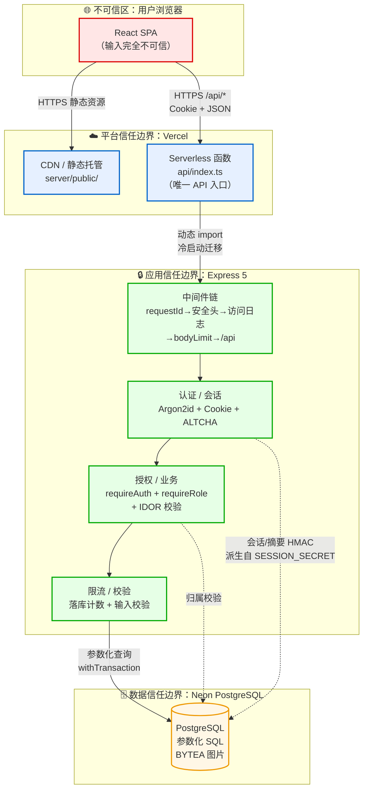

# 星聚 STARPAL · 威胁模型（内部详版）

> 版本：v1.7.0　编制日期：2026-11-18　性质：**基于源码与部署配置的 STRIDE 结构化威胁分析**
> 方法论：OWASP 威胁建模四问框架 + STRIDE 六分类 + 信任边界 / 数据流图（DFD）
> 配套：`docs/THREAT-MODEL-PUBLIC.md`（脱敏对外版）、`docs/SELF-AUDIT-2026-11-17.md`（同期静态自审）
> 许可：CC BY-NC-SA 4.0（见 `LICENSE-docs`）

## 边界声明（务必先读）

- 这是一份**基于源码静态分析 + 文档核对**的威胁模型，**不是**渗透测试、第三方安全审计或法律意见。
- 文中"缓解措施"指**代码中确有对应实现**，并给出文件路径佐证；"有效"指逻辑上覆盖该威胁路径，**不等于经过攻击验证**。
- STRIDE 分析的是"**可能出现什么问题**"，其中相当一部分是**已缓解**或**当前架构下不可达**的——列出不等于存在待修漏洞。真正需要跟进的项集中在第八节"残余风险与待办"。
- 威胁模型是**活文档**：新功能上线、安全事件、架构或基础设施变更后须复核（见第九节）。

---

## 一、方法：OWASP 四问框架

本模型围绕 OWASP 与《威胁建模宣言》公认的四个问题组织，全文即这四个问题的回答：

| 问题 | 本文对应章节 |
| --- | --- |
| ① 我们在做什么？（What are we working on?） | 二、系统画像 · 三、数据流与信任边界 |
| ② 可能出什么错？（What can go wrong?） | 五、STRIDE 逐类分析 · 六、按组件拆解 |
| ③ 我们打算怎么办？（What are we going to do about it?） | 五、每条威胁下的"现有缓解" · 七、缓解措施汇总 |
| ④ 我们做得够好吗？（Did we do a good enough job?） | 八、残余风险 · 九、验证与复核 · 十、结论 |

**为什么选 STRIDE**：它由微软提出、是业内最主流的威胁分类法，六个字母对应六类威胁，能系统覆盖 Web 应用的典型风险面，与本项目"认证—授权—内容—互动"的结构高度契合。分类如下：

| 缩写 | 全称 | 违背的安全属性 | 大白话 |
| --- | --- | --- | --- |
| **S** | Spoofing（仿冒） | 真实性 Authenticity | 冒充别人 |
| **T** | Tampering（篡改） | 完整性 Integrity | 偷偷改数据 |
| **R** | Repudiation（抵赖） | 不可抵赖性 Non-repudiation | 干了不认、查不到 |
| **I** | Information Disclosure（信息泄露） | 机密性 Confidentiality | 看到不该看的 |
| **D** | Denial of Service（拒绝服务） | 可用性 Availability | 让系统瘫掉 |
| **E** | Elevation of Privilege（提权） | 授权 Authorization | 拿到不该有的权限 |

---

## 二、系统画像

### 2.1 产品本质（建模前提）

星聚是一个**已上线的、邀请制、非商业、小规模真实用户**的兴趣社区。这个定位直接决定威胁模型的取舍：

- **邀请制**：注册不是开放的，需要有效邀请码 + 人机验证，天然抬高批量注册门槛——但无法彻底阻断（PRD `R-03` 已承认）。
- **非商业、小规模**：没有支付、没有真实货币、没有高价值资产，**攻击者经济动机低**；威胁多来自自动化脚本、好奇试探、被针对的骚扰，而非有组织的牟利攻击。
- **真实用户**：可用性、隐私、反骚扰比"绝对防渗透"更贴近真实需求。

### 2.2 技术栈与组件清单

| 层 | 组件 | 版本/配置依据 | 在信任模型中的角色 |
| --- | --- | --- | --- |
| 客户端 | React 19 SPA（Vite 构建） | `web/package.json` | 完全不可信的输入源 |
| 分发 | Vercel CDN + 静态托管 `server/public/` | `vercel.json` | 平台信任边界 |
| 入口 | Serverless 函数 `api/index.ts` | `vercel.json` rewrite `/api/:path*` | 唯一 API 入口、冷启动迁移 |
| 应用层 | Express 5 `api-app.ts` / `app.ts` | `server/src/routes.ts` | 认证授权与业务逻辑 |
| 数据层 | PostgreSQL（Neon），`pg` Pool max=10 | `server/src/db/pool.ts` | 可信数据边界 |
| 图片存储 | 二进制存 BYTEA（`ADR-014`） | `server/src/storage/postgres-bytea.ts` | 数据层一部分 |
| 人机验证 | 自托管 ALTCHA（工作量证明） | `server/src/modules/auth/altcha.ts` | 反自动化 |
| 头像生成 | 自托管 DiceBear（31 风格） | `server/src/modules/images/avatar*` | 无外部请求 |
| 外部服务 | **无出站 HTTP 调用** | 服务端源码零 `fetch` | 攻击面显著缩小 |

> **关键事实**：服务端**不发任何外部网络请求**。ALTCHA 与 DiceBear 全部自托管。这消除了整类"第三方 API 被攻破波及我们""SSRF""出站数据外泄"的威胁——这是本项目一个重要的结构性安全优势。

### 2.3 需要保护的核心资产

| 资产 | 存储位置/形态 | 机密性 | 完整性 | 可用性 |
| --- | --- | --- | --- | --- |
| 用户口令 | Argon2id PHC 串 `users.password_hash` | 高 | 高 | 中 |
| 会话凭证 | 不透明 ID + `sessions` 表 + HttpOnly Cookie | 高 | 高 | 中 |
| 邀请码 | 仅存 HMAC 摘要，明文生成时返回一次 | 高 | 高 | 中 |
| 私信正文 | `messages.body` **明文 TEXT** | 中 | 中 | 中 |
| 用户资料 / 帖子 / 评论 | 数据库明文 | 中 | 高 | 中 |
| 上传图片 | BYTEA，重编码 WebP | 中 | 高 | 中 |
| 管理权限 | `users.role`（user/admin） | 高 | 高 | 高 |
| 平台密钥 | `SESSION_SECRET`（唯一必需密钥） | 极高 | 极高 | 极高 |
| 服务可用性 | Vercel + Neon + 限流配额 | — | — | 高 |

---

## 三、数据流与信任边界

### 3.1 系统数据流图（DFD）

下图标注了**信任边界**（虚线）。跨边界的每条箭头都是潜在的攻击面。

### 3.2 信任边界清单

| # | 边界 | 跨边界的数据 | 主要防线 |
| --- | --- | --- | --- |
| TB-1 | 浏览器 → Vercel CDN | 静态资源请求 | HTTPS（平台）、CSP |
| TB-2 | 浏览器 → Serverless API | JSON、Cookie、上传文件、查询参数 | bodyLimit、输入校验、ALTCHA、限流、安全头 |
| TB-3 | Serverless → Express 应用 | 已解析的请求 + 可信 IP（XFF 由 Vercel 覆盖） | 中间件固定顺序、fail-closed |
| TB-4 | Express → PostgreSQL | SQL 参数、事务、二进制 | 参数化查询、白名单、withTransaction |
| TB-5 | 应用 → 密钥 | `SESSION_SECRET` 派生子密钥 | HKDF 域隔离、仅环境变量注入、不入库 |
| TB-6 | CI/CD → 仓库 | 源码、依赖 | 质量门、CodeQL、无凭据、只读权限 |

### 3.3 关键平台假设（威胁模型的地基）

以下防线**依赖平台行为成立**，一旦假设被打破，风险显著上升，须单独跟踪：

- **A1（已加固）**：原始假设是"Vercel 会覆盖 `x-forwarded-for` 为真实客户端 IP，且不转发外部传入的同名头"。Vercel 官方 Request headers 文档确认了覆盖行为，但同时指出 `x-forwarded-for` 在"Vercel 之上再挂代理"时可能被改写。**处置**：`subject.ts` 不再取链首值，改为取**最右一跳**（最近一跳写入的值）——覆盖模式下与原先等价，追加模式下仍取真实来源，因此不再依赖该假设。回归用例见 `auth-failure-limit.test.ts` 的"转发链只信最右一跳"（6 项，含中间件链路与变异验证）。残余：若攻击者能直连函数实例绕过 Vercel 边缘（平台不提供该路径），本机制不适用。
- **A2**：Vercel 注入 HSTS（`max-age=63072000`），应用层刻意不加以避免双头。已 curl 实测。
- **A3**：`SESSION_SECRET` 保密且不轮换（轮换会使全部会话失效并同时轮换派生密钥）。
- **A4**：Neon PostgreSQL 只接受应用层参数化访问，不对外暴露可直连的写端口。

---

## 四、攻击者画像与攻击面

### 4.1 攻击者画像

| 画像 | 能力 | 动机 | 现实性 |
| --- | --- | --- | --- |
| 自动化脚本 / 爬虫 | 批量 HTTP、换 IP、基础绕过 | 刷注册、灌水、撞库 | 高（邀请码 + ALTCHA + 限流主要防它） |
| 注册用户（内部人） | 合法会话，可发帖/私信/举报 | 骚扰、刷屏、试探越权 | 中（IDOR 防护与写限流针对它） |
| 管理员凭证失陷 | 完整管理权限 | 数据破坏、信息窃取 | 低但影响极大 |
| 定向攻击者 | 真人、社工、针对性探测 | 针对特定用户 | 低（小规模非商业社区） |
| 供应链攻击者 | 投毒依赖、 exploit 0day | 广泛攻击 | 低（但 picomatch 事件属此类，见残余风险） |

### 4.2 攻击面清单（按入口）

| 入口 | 暴露接口 | 输入类型 | 主要威胁类别 |
| --- | --- | --- | --- |
| 注册 / 登录 | `/api/auth/*` | 用户名、口令、邀请码、ALTCHA 载荷 | S（仿冒）、D（爆破）、E |
| 内容写接口 | `/api/posts` `/comments` `/reports` | 文本、ID、排序参数 | T（越权改）、D（灌水）、I（IDOR） |
| 图片上传 | `/api/images` `/posts/:id/images` | 二进制文件 | T（恶意文件）、D（解压炸弹）、I |
| 私信 | `/api/messages` | 文本、用户 ID | I（越权读）、D（骚扰刷屏） |
| 管理接口 | `/api/admin/*` | 各类管理操作 | E（提权）、T |
| 查会话 | `/api/auth/me` `/health` `/meta/*` | 少量参数 | I（信息泄露） |
| 数据导出 | `/api/export` | 身份 | I（越权导出） |
| 头像生成 | `/api/avatars/*` | 风格、种子（URL 参数） | T（SVG 注入）、D |

---

## 五、STRIDE 逐类分析

> 每条威胁给出：**威胁描述 → 现实性 → 现有缓解（带证据）→ 残余风险**。
> 标注 `[已缓解]` 表示代码中有对应防线；`[部分]` 表示有防线但有边界；`[不可达]` 表示当前架构下攻击者无法触达；`[待办]` 表示需跟进（汇总到第八节）。

### 5.1 S — Spoofing（仿冒 / 冒充他人身份）

**S1. 口令爆破登录** `[已缓解]`
- 威胁：攻击者对已知用户名反复试密码，直到猜中。
- 缓解：① 登录前置 ALTCHA 工作量证明（`auth.routes.ts`，`require-altcha.ts`），每台自动化请求都要算一次 PoW，抬高单位成本；② 登录失败 5 次锁定，计数落 `security_events` 表、键为来源 IP 摘要（`rate-limit.ts`，`constants.ts:LOGIN_FAIL_MAX`）；③ Argon2id 慢哈希（64 MiB / 3 轮，`password.ts`）；④ 账户不存在时用固定 `DUMMY_HASH` 走相同流程对齐时序，防用户名枚举（`auth.service.ts:34,115`）。
- 残余：ALTCHA 提高成本但非绝对阻断定向人工攻击；来源标识已改为取转发链最右一跳，不再依赖平台覆盖假设（见 A1）。

**S2. 会话仿冒（盗用 Cookie）** `[已缓解]`
- 威胁：攻击者窃取或伪造会话 Cookie 冒充登录用户。
- 缓解：① 会话 ID 为 32 字节 `randomBytes` base64url，不可猜测（`session.ts`）；② Cookie `HttpOnly`（JS 读不到）+ `Secure`（HTTPS 时）+ `SameSite=Lax` + `Max-Age=168h`（`session.ts`、`subject.ts:isSecureRequest`）；③ 会话存服务端表，登出即删、改密撤销其它会话（`auth.repository.ts:runPasswordChange`）；④ 解析时用正则校验 base64url 格式，拒绝畸形。
- 残余：XSS 若存在仍可能借用户身份发请求（HttpOnly 挡住直接读 Cookie，但挡不住"带 Cookie 代发"）——见 5.4 I 类 XSS 分析。`SameSite=Lax` 未用 `Strict`，属权衡。

**S3. 邀请码猜测 / 批量注册** `[部分]`
- 威胁：攻击者暴力枚举邀请码，或绕过邀请制批量注册小号。
- 缓解：① 邀请码为高熵随机，仅存 HMAC 摘要（`invite.repository.ts:36`），明文只在生成时返回一次；② 注册前置 ALTCHA + 来源限流；③ 蜜罐字段 `website`（机器人会填，真人不会）；④ 一人一码、用完即失效、可撤销。
- 残余：PRD `R-03` 明确承认**无法彻底阻断**有耐心的批量注册；无邮箱/手机验证意味着无法做更强的真人约束。接受项。

**S4. 换 User-Agent 绕过限流** `[已缓解，本轮修复]`
- 威胁：攻击者每次请求换一个 UA，让限流键变化、计数永远归零。
- 缓解：限流来源摘要 `subjectHashOf` **只用可信 IP**（转发链最右一跳），不再拼 UA（`subject.ts`）；验证见 `auth-failure-limit.test.ts` 的"换 UA 仍被限流"与"转发链只信最右一跳"两组用例。
- 残余：无（已移除对 A1 平台假设的依赖）；不受控的 IP 共享（NAT / 公共出口）会造成限流过严误伤，属可用性取舍。

### 5.2 T — Tampering（篡改 / 偷偷改数据）

**T1. SQL 注入** `[已缓解]`
- 威胁：在输入里拼 SQL，读写任意数据。
- 缓解：全部仓储用参数化查询；唯一动态列名 `interaction.repository.ts:48` 来自 TS 联合类型白名单（`like_count|bookmark_count`）；动态排序/LIKE 均来自服务端白名单且通配符已转义（`SELF-AUDIT §二 注入`）。

**T2. IDOR / 越权改他人内容** `[已缓解]`
- 威胁：改 URL 里的 ID 就能删改别人的帖子、评论、资料。
- 缓解：① 帖子 `authorize()` 校验作者或管理员，不可见内容统一返回 `NOT_FOUND` 防枚举（`post.service.ts:78-89`）；② 评论删除校验作者或管理员（`comment.service.ts:94`）；③ 上传、评论复用 `ensurePostEditable`；④ 管理操作在 Router 统一 `requireAuth + requireRole` 后再由服务层二次复核 admin（`admin.routes.ts:37`、`admin.moderation.service.ts:37`）。

**T3. 恶意文件上传 / 存储型攻击** `[已缓解]`
- 威胁：上传伪装成图片的脚本、SVG XSS、解压炸弹、超大文件。
- 缓解：① multer 内存缓冲 3MB、单文件、0 字段（`upload.ts`），**不信任客户端 mimetype**；② 魔数白名单 jpeg/png/webp/avif，**明确拒绝 SVG/GIF/HEIC**；③ sharp 解码双重比对格式 + `limitInputPixels=40,000,000` 防解压炸弹；④ 统一重编码 WebP（剥离 EXIF/元数据），读路径带 `nosniff`（`image-pipeline.ts`、`image.controller.ts`）。
- 残余：头像 SVG 是特例——由服务端 DiceBear 生成、非用户上传，走独立沙箱 CSP + nosniff（`avatar.controller.ts`），并已规避历史 SVG 注入漏洞。

**T4. 请求体过大 / 畸形** `[已缓解]`
- 威胁：超大 JSON 撑爆内存、畸形结构打崩解析。
- 缓解：`bodyLimit` 强制写请求 4MB 上限（`body-limit.ts`）；`requireString/requireObject/requireEnum` 校验类型、码点长度、孤立代理项、URL 白名单（`shared/validation.ts`）；全局 `errorHandler` 兜底，不回堆栈。

**T5. CSRF（跨站请求伪造）** `[已缓解，当前架构]`
- 威胁：诱导用户浏览器带着 Cookie 向本站发写请求。
- 缓解：Session Cookie `SameSite=Lax`（跨站 POST 不带 Cookie）+ 无状态变更型 GET 操作，二者叠加使经典 CSRF 当前不成立（`SELF-AUDIT §边界说明`）。
- 残余：未加 CSRF token、未用 `Strict`；若未来引入状态变更型 GET 或放宽 SameSite 需重新评估。

### 5.3 R — Repudiation（抵赖 / 干了不认、查不到）

**R1. 操作无审计日志** `[部分]`
- 威胁：管理员误操作或恶意操作后无法追溯；用户否认发过某内容。
- 缓解：① `accessLog` 中间件记录请求；② `requestId` 贯穿请求链路；③ 限流与安全事件落 `security_events` 表；④ 举报、审核决策落库。
- 残余：**没有面向管理员操作的完整审计日志**（谁在何时改了什么），这是当前明确的空白。小规模信任社区可接受，但一旦出现管理员纠纷将难以取证。**建议纳入待办**（见第八节 R-1）。

**R2. 限流事件被清理** `[部分]`
- 威胁：安全事件按保留期清理后，历史攻击痕迹消失。
- 缓解：`SECURITY_EVENT_RETENTION_DAYS` 控制保留期，过期记录随认证链路顺带清理。
- 残余：保留期是可用性（省存储）与取证能力的权衡；当前无长期归档。

### 5.4 I — Information Disclosure（信息泄露 / 看到不该看的）

**I1. IDOR 越权读私信 / 举报 / 导出** `[已缓解]`
- 威胁：改 ID 读别人的私信、"我的举报"、导出数据。
- 缓解：① 私信读取校验会话用户是参与者（`messages.service.ts:137-159`）；② 举报按 `reporter_id` 过滤；③ 导出限本人（`modules/export/`）；④ 不可见内容统一 `NOT_FOUND`，防资源枚举。

**I2. 错误堆栈 / 敏感细节泄露** `[已缓解，本轮修复]`
- 威胁：异常时把堆栈、源码路径、连接串回给公网。
- 缓解：`api/index.ts` 兜底 catch 与 `errorHandler` 只写服务端日志，客户端回固定 `{error:'internal_error'}` + requestId；CodeQL 与密钥扫描在 CI 拦截硬编码密钥。

**I3. 口令 / 邀请码 / 密钥以明文或可逆形式泄露** `[已缓解]`
- 威胁：数据库泄漏后直接拿到可用凭证。
- 缓解：① 口令 Argon2id 单向哈希；② 邀请码存 HMAC 摘要、明文仅生成时返回一次；③ 会话 ID / 来源摘要 / ALTCHA 载荷摘要均为不透明或不可逆值；④ `SESSION_SECRET` 仅环境变量注入、`.env` 不入库、CI 无凭据，子密钥经 HKDF 域隔离派生。
- 残余：**私信正文是明文 TEXT**，无字段级加密（`013` 迁移），靠参与者校验 + TLS 传输保护。若数据库整体泄漏，私信内容可读——这是明确的设计取舍，须让用户知情（见第八节 I-1）。

**I4. XSS / SVG 注入** `[已缓解]`
- 威胁：在帖子内容或头像里注入脚本，窃取信息或代发请求。
- 缓解：① React 默认转义；② 严格 CSP（`default-src 'self'; script-src 'self'; frame-ancestors 'none'`，`security-headers.ts`）；③ 拒绝 SVG 上传；④ 头像 SVG 走独立沙箱 CSP `default-src 'none'; sandbox` + nosniff；⑤ 规避 DiceBear 历史 SVG 注入漏洞（选 `core@9.4.3` 并逐包安装）。
- 残余：CSP `style-src` 含 `'unsafe-inline'`（Tailwind 所需），属已知取舍。

**I5. 元数据 / 头部泄露** `[已缓解]`
- 缓解：`X-Frame-Options: DENY`、`Referrer-Policy: strict-origin-when-cross-origin`、`Permissions-Policy` 关闭摄像头/定位/支付等设备、`X-Content-Type-Options: nosniff`、`COOP/COP: same-origin`，`x-powered-by` 关闭（`security-headers.ts`、`app.ts`）。

### 5.5 D — Denial of Service（拒绝服务 / 让系统瘫掉）

**D1. 写接口灌水 / 刷屏** `[部分]`
- 威胁：自动化脚本大量发帖/评论/举报/上传，淹没内容、耗尽配额。
- 缓解：四类写接口独立限流（post_create / comment_create / report_submit / image_upload），计数落库、按来源摘要，达阈值返回 429（`write-rate-limit.ts`）；ALTCHA 前置抬高自动化成本。
- 残余：**部分写接口无写限流**——私信、改密、资料修改、话题/公告/邀请码管理（自审 §边界说明）。其中**私信可被登录后刷屏骚扰**是真实缺口。见第八节 D-1。

**D2. 注册 / 登录撞库与算力滥用** `[已缓解]`
- 缓解：注册、登录、ALTCHA 挑战生成均前置人机验证 + 来源限流；挑战生成本身也限流，避免被当免费算力池（`altcha.ts`、`require-altcha.ts`）。

**D3. 上传资源耗尽 / 解压炸弹** `[已缓解]`
- 缓解：见 T3（3MB 上限、`limitInputPixels`、单文件、内存缓冲）。

**D4. 请求体 / 连接耗尽** `[部分]`
- 缓解：4MB bodyLimit；Serverless 按请求弹性伸缩；DB Pool max=10 防止连接爆炸（`pool.ts`）。
- 残余：项目为**单实例、无水平扩展**（PRD `R-01`）；面对大规模分布式低速攻击缺乏弹性扩容手段，依赖平台层防护。接受项。

**D5. ReDoS（正则拒绝服务）** `[不可达 / 已登记]`
- 威胁：用恶意正则输入卡死事件循环。
- 分析：唯一real来源是前端构建/测试工具链的 `picomatch@4.0.7`（CVE-2026-112366，**无补丁**，EPSS 0.335%）。本项目源码零 glob 调用、恶意模式无输入入口、生产运行时零命中（详见 `SELF-AUDIT` 基线更正 + 方案 A 结论）。
- 残余：不可达，但作为已知风险登记；触发条件见第八节 X-1。

### 5.6 E — Elevation of Privilege（提权 / 拿到不该有的权限）

**E1. 普通用户提权为管理员** `[已缓解]`
- 威胁：通过构造请求、改数据库字段或利用接口获得 admin 权限。
- 缓解：① 角色仅 user/admin，来自服务端 `users.role`（`constants.ts:225`）；② 展示用头衔（community_leader 等）与权限完全解耦；③ 管理路由整组 `requireAuth + requireRole(ROLE_ADMIN)`，缺 principal 时 fail-closed（`require-role.ts`）；④ 服务层二次复核 admin；⑤ 无公开管理员注册，只能通过 `scripts/init-admin.mjs` 在本地初始化。

**E2. 会话固定 / 越权会话** `[已缓解]`
- 缓解：登录时新建 sessionId（不复用），无 session fixation；改密撤销其它会话；服务端会话表可随时失效。

**E3. 通过管理接口执行越权操作** `[已缓解]`
- 缓解：管理接口统一守卫 + 服务层二次复核（见 E1）；管理操作经 `withTransaction` 保证跨表一致性。

### 5.7 STRIDE 覆盖度小结

| 类别 | 威胁条目 | 已缓解 | 部分 | 不可达/登记 | 需跟进 |
| --- | --- | --- | --- | --- | --- |
| S 仿冒 | 4 | 3 | 1 | 0 | 0（A1 已加固） |
| T 篡改 | 5 | 5 | 0 | 0 | 0 |
| R 抵赖 | 2 | 0 | 2 | 0 | 1 |
| I 信息泄露 | 5 | 5 | 0 | 0 | 1（知情项） |
| D 拒绝服务 | 5 | 3 | 2 | 1 | 1 |
| E 提权 | 3 | 3 | 0 | 0 | 0 |

---

## 六、按组件拆解（交叉验证视角）

STRIDE 按"威胁类型"纵向切，本节按"系统组件"横向切，交叉验证有没有遗漏——同一个组件可能同时面临多类威胁。这是《威胁建模宣言》"多种表示优于单一完美视图"的实践。

| 组件 | 面临的主要威胁 | 防线定位 | 薄弱点 |
| --- | --- | --- | --- |
| 注册/登录 | S1/S3/S4, D2 | ALTCHA + 限流 + Argon2id + 蜜罐 | 无法彻底防批量注册；限流已不依赖 XFF 首值（A1 已加固） |
| 会话管理 | S2, E2 | 不透明 ID + Cookie 属性 + 服务端会话表 | XSS 可代发请求；SameSite=Lax 非 Strict |
| 内容 CRUD | T1/T2, I1, D1 | 参数化 + authorize + NOT_FOUND + 写限流 | 部分管理类写操作无限流 |
| 图片上传 | T3, D3 | 魔数 + 双重解码 + 重编码 + 像素上限 | 无（当前防线完整） |
| 私信 | I1, D1 | 参与者校验 | **无写限流，可登录刷屏骚扰** |
| 管理后台 | E1/E3, R1 | 整组守卫 + 服务层复核 | **无完整管理操作审计日志** |
| 头像生成 | I4, D5 | 沙箱 CSP + 白名单 + 规避历史漏洞 | 依赖上游 DiceBear 安全 |
| API 入口 | I2, T4 | 兜底 catch 不回堆栈 + bodyLimit + 安全头 | 冷启动首次迁移的可用性依赖 DB |
| 数据层 | T1, I3 | 参数化 + 白名单 + 事务 | 私信明文存储（知情取舍） |
| CI/CD | T（供应链）, I（密钥） | 质量门 + CodeQL + 无凭据 + 只读权限 | `npm audit` 14 high 未纳入门禁（已登记） |

---

## 七、缓解措施汇总（防御地图）

把全文的防线按"安全能力"归并，便于回答"我们为安全做了什么"：

| 安全能力 | 具体实现 | 证据位置 |
| --- | --- | --- |
| **反自动化** | 自托管 ALTCHA 工作量证明 + 蜜罐字段；前置注册/登录/挑战 | `altcha.ts` / `require-altcha.ts` / `auth.routes.ts` |
| **抗爆破** | 失败次数锁定（落库计数）+ 来源摘要（不含 UA）+ 时序对齐 | `rate-limit.ts` / `subject.ts` / `auth.service.ts` |
| **强认证** | Argon2id（WASM）+ 不透明会话 + HttpOnly/Secure Cookie | `password.ts` / `session.ts` |
| **细授权** | 角色守卫 fail-closed + 服务层二次复核 + 逐资源 IDOR 校验 | `require-role.ts` / `*service.ts` |
| **输入安全** | bodyLimit + 类型/长度/正则校验 + 参数化 SQL + 白名单 | `body-limit.ts` / `validation.ts` / `*.repository.ts` |
| **上传安全** | 魔数 + 双重解码 + 重编码剥 EXIF + 像素上限 + nosniff | `upload.ts` / `image-pipeline.ts` |
| **浏览器加固** | CSP + COOP/CORP + Permissions-Policy + nosniff + DENY 帧 | `security-headers.ts` |
| **数据保护** | Argon2id 口令 + HMAC 邀请码 + HKDF 域隔离密钥派生 | `password.ts` / `invite.repository.ts` / `altcha.ts` |
| **可观测性** | requestId + accessLog + 安全事件落库 + 错误不回堆栈 | `api-app.ts` / `api/index.ts` |
| **持续保障** | `npm run verify` 六道质量门 + CodeQL + 迁移只增不改 | `verify.yml` / `codeql.yml` / `migrate.ts` |

---

## 八、残余风险与待办（真正需要跟进的清单）

> 这是全文最需要决策者关注的部分。前面各节的"残余"汇总到这里，按优先级排序。
> **注意**：这些是"已知且接受/待评估"的风险，不是"未发现的漏洞"。

| 编号 | 残余风险 | 类别 | 当前状态 | 建议 |
| --- | --- | --- | --- | --- |
| **A1** | 限流依赖"Vercel 覆盖 XFF 首值"这一平台假设，若平台行为变更则限流可绕过 | S/D | ✅ **已加固（2026-11-18）**：改为取转发链最右一跳，不再依赖该假设 | 无需跟进；若将来在 Vercel 前引入 CDN/代理，复核取值方向并补实测 |
| **D-1** | 私信无写限流，登录用户可刷屏骚扰 | D | 明确缺口 | 评估给私信发送加配额（复用现有 write-rate-limit 原语） |
| **R-1** | 无面向管理员操作的完整审计日志 | R | 明确空白 | 小规模信任社区可接受；若发生管理员纠纷则难以取证，届时补审计表 |
| **I-1** | 私信正文明文存储，无字段级加密 | I | 知情取舍 | 向用户如实说明；数据库整体泄漏时私信可读 |
| **X-1** | `npm audit` 14 high（picomatch ReDoS，无补丁，生产不可达） | D | 已拍板方案 A：维持现状+登记 | 触发条件：上游出补丁 >4.0.7，或本项目开始用 picomatch 处理外部输入 |
| **X-2** | 文档称邀请码"恒定时间比较"，代码实为 `UPDATE ... WHERE code_hash=$1`（无 `timingSafeEqual`） | — | 表述与实现细微出入 | 下轮文档同步时修正表述，或评估是否需真正恒定时间比较 |
| **X-3** | 未做动态渗透（OWASP ZAP）、真浏览器 axe、运行时告警验证 | — | 明确边界 | 如需对外声称更强安全，须先补这些取证 |

**优先级建议**：D-1（真实骚扰面）> X-2（文档一致性，改动小）> R-1 / I-1（知情接受或择机改进）> X-3（取证，按需）> X-1（等触发条件）。**A1 已结案**，不再列入优先级。

---

## 九、验证与复核

### 9.1 "我们做得够好吗"——本模型的验证方式

- **可追溯性**：每条"现有缓解"都给出源码路径，可逐条核对；不写无实现的声明。
- **交叉验证**：STRIDE（按威胁类型）+ 组件拆解（按系统组件）两个维度互相查漏。
- **与实测对照**：本模型与 `docs/SELF-AUDIT-2026-11-17.md` 同源，自审的 `npm run verify` 全绿（后端 328/328、前端 105、覆盖率 96.52%）为防线"存在且能编译/测试"提供证据。**但静态分析不等于攻击验证**——本模型不声称任何防线经过渗透测试。
- **变异验证**：本轮安全修复（限流绕过等）做了变异测试，证明对应回归测试非空摆设。

### 9.2 复核触发条件（活文档）

按 OWASP 与威胁建模宣言"持续改进优于一次性交付"的原则，以下情况发生后须复核并更新本模型：

1. **新功能上线**——尤其引入新的用户输入面、新的外部服务、新的权限角色；
2. **安全事件发生**——无论是否成功；
3. **架构 / 基础设施变更**——如更换部署平台、更换数据库、引入出站调用；
4. **平台假设变化**——特别是转发头取值方向（A1 加固点）与部署平台更替；
5. **依赖安全变化**——X-1 的触发条件出现；
6. **定期复核**——建议每半年通读一次，即使无变更。

---

## 十、结论

星聚的安全态势可以概括为：**在一个经济动机低、邀请制、小规模的非商业社区定位下，实现了超出平均水平的纵深防御**——反自动化、抗爆破、强认证、细授权、输入安全、上传安全、浏览器加固、数据保护、可观测性、持续保障十个能力面均有代码级实现。

本模型识别的 24 条威胁中，绝大多数已缓解或在当前架构下不可达；真正需要决策者关注的残余集中在第八节，其中 **A1（平台假设）已于本轮加固结案，D-1（私信刷屏）是当前唯一的功能性实质缺口**，其余为知情接受、文档一致性或取证边界。

**诚实的边界**：本模型是静态分析产物，不是安全认证。它让安全决策有据可依，但不能证明"没有漏洞"。项目对外口径仍以 README 声明为准——**未经第三方安全审计，不建议用于处理敏感信息**。

---

> 附：脱敏对外版见 `docs/THREAT-MODEL-PUBLIC.md`，供向社区展示安全投入使用，不含 CVE 编号、内部路径与残余风险细节。